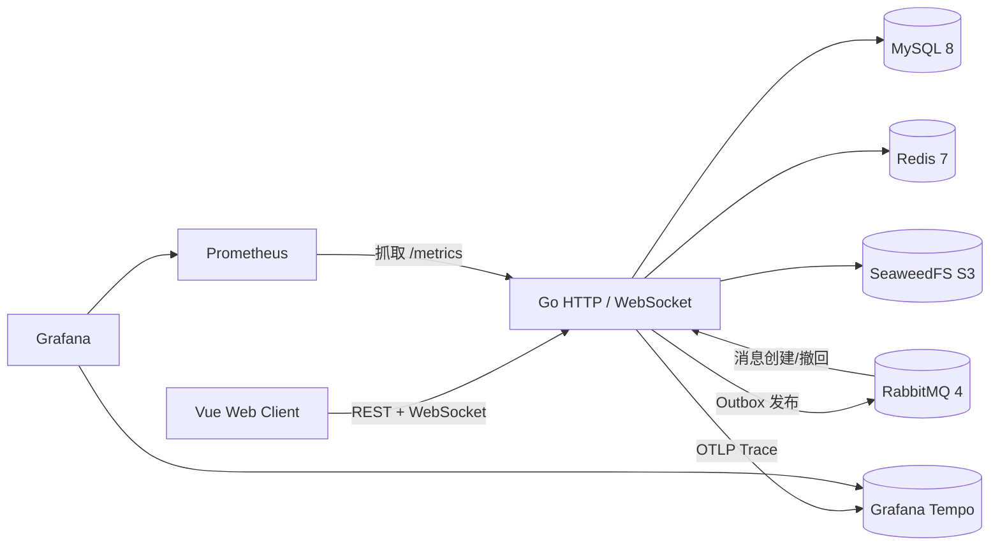

# RelayIM

RelayIM 是一个面向工程实践的即时通讯项目。项目保留单体应用的开发效率，同时实现了可靠消息、一次性 WebSocket Ticket、消息幂等、断线补拉、对象存储、限流和 Prometheus 观测等生产环境常见能力。

当前目标是做出可演示、可复现、可解释的单机 Web IM，并继续补强故障注入、长稳测试和运维告警。

## 已实现能力

- 账号注册、登录、Refresh Token 原子轮换、服务端退出登录。
- 个人昵称、头像上传/移除和个人简介编辑。
- 好友申请理由、接受、拒绝、独立备注、单向删除、拉黑、游标分页和私聊创建。
- 私聊与群聊统一会话模型，支持会话标题搜索、个人置顶、复合游标分页和完整群权限矩阵。
- 群主和管理员可填写邀请备注并发送入群邀请，受邀者带回复备注审批后入群；支持过期、取消、同意和拒绝记录。
- 群主可以修改群名称、群头像、转让群主或解散群。
- 文本、图片和普通文件消息。
- 消息幂等、会话内连续 `seq`、最新页重同步、历史懒加载和实时缺口补拉。
- 聊天记录面板和会话内中文消息全文搜索，支持结果游标分页。
- WebSocket 单写协程、有界队列、送达 ACK、已读游标和慢连接隔离。
- Redis 多设备在线状态、批量查询和前端在线人数展示。
- Redis 实例路由与 RabbitMQ 节点队列，支持跨 Go 实例 WebSocket 投递。
- 群邀请创建、重新激活和取消通过 Outbox、RabbitMQ 与 WebSocket 实时通知。
- 好友关系发生变化、私聊首次创建时实时刷新双方联系人及会话列表。
- 客户端连续序号水位、缺口补拉和防越级已读游标。
- 消息撤回、群主转让和群解散。
- Outbox + RabbitMQ Publisher Confirm + 手动 ACK + TTL 重试 + DLQ。
- Snowflake 启动时间水位校验，小幅时钟回拨等待、大幅回拨拒绝启动。
- 注册、登录、好友申请、消息发送、消息撤回和附件上传滑动窗口限流。
- SeaweedFS S3 兼容附件存储、短时预签名访问和附件归属校验。
- Prometheus 指标、健康检查、请求 ID、结构化日志和 Grafana 面板。
- OpenTelemetry 消息链路 Trace、OTLP 导出、Tempo 存储和异步 `traceparent` 传播。
- 孤儿附件定时清理、清理租约、失败重试和 Prometheus 指标。
- Vue 3 + TypeScript 演示前端，覆盖核心聊天流程。
- QQ 式左侧导航、会话/联系人列表、联系人资料主区和头像放大交互。

## 架构



核心消息链路：

```text
HTTP 发送
  -> MySQL 事务：message + last_seq + outbox
  -> Outbox Worker
  -> RabbitMQ
  -> Consumer 幂等处理
  -> 本实例在线 WebSocket 扇出
  -> 客户端 ACK / Read
```

接口成功只表示消息和 Outbox 已经提交，不宣称 RabbitMQ Exactly Once。实时链路采用至少一次投递，消息顺序以会话内 `seq` 为准，客户端按 `message_id` 去重。

## 技术栈

| 层级 | 技术 |
| --- | --- |
| 后端 | Go 1.26.10、Gin、GORM |
| 数据库 | MySQL 8.0 |
| 缓存与限流 | Redis 7.4、Lua + ZSET 滑动窗口 |
| 消息队列 | RabbitMQ 4.3、amqp091-go |
| 对象存储 | SeaweedFS S3 兼容接口、MinIO Go SDK |
| 可观测性 | OpenTelemetry、Tempo、Prometheus、Grafana、slog、Request ID |
| 前端 | Vue 3、TypeScript、Vite、Pinia、Vue Router |
| 部署 | Docker 多阶段构建、Nginx、Docker Compose |
| 压测 | k6 |
| 质量门禁 | GitHub Actions、go vet、go test、race、govulncheck、npm audit、vue-tsc、Vite build |

## 快速启动

### 1. 启动基础设施

```powershell
Copy-Item deploy\.env.example deploy\.env
docker compose --env-file deploy\.env -f deploy\docker-compose.yml up -d
```

默认启动 RabbitMQ、Redis、SeaweedFS、Tempo、Prometheus 和 Grafana。MySQL 使用本机已有实例，不要求重装。

### 2. 全容器启动

该方式会额外启动 MySQL、执行 Goose migration、构建 Go 后端和 Nginx 前端，不依赖本机 Go、Node 或 MySQL：

```powershell
Copy-Item deploy\.env.example deploy\.env
Copy-Item deploy\app.env.example deploy\app.env
```

修改两个 env 文件中的密码和 JWT 密钥，然后执行：

```powershell
docker compose `
  --env-file deploy\.env `
  --env-file deploy\app.env `
  -f deploy\docker-compose.yml `
  -f deploy\docker-compose.app.yml `
  up -d --build
```

打开 `http://localhost:8080`。后端直连地址为 `http://localhost:8081`，容器 MySQL 映射到 `127.0.0.1:3307`。迁移容器每次执行 `goose up`，已应用的版本会自动跳过。

全容器启动后不需要继续执行下面基于本机工具链的数据库、后端和前端步骤。

### 3. 初始化本机数据库

```powershell
go install github.com/pressly/goose/v3/cmd/goose@v3.24.3
goose -dir migrations mysql "root:你的密码@tcp(127.0.0.1:3306)/relayim?charset=utf8mb4&parseTime=true&loc=UTC" up
```

数据库字段、索引和约束说明见 [数据库开发指南](docs/数据库开发指南.md)。

### 4. 配置并启动本机后端

```powershell
Copy-Item internal\config\app.env.example internal\config\app.env
.\scripts\run-server.ps1
```

本地配置不会提交 Git。至少需要填写 MySQL、JWT、Redis、RabbitMQ 和 S3 凭据，具体变量见 [配置管理指南](docs/配置管理指南.md)。

### 5. 启动本机前端

```powershell
Set-Location web
npm ci
npm run dev
```

打开 `http://127.0.0.1:5173`。

如需一键生成演示账号、好友、私聊、群聊、管理员和撤回消息：

```powershell
.\scripts\seed-demo.ps1
```

脚本会输出四个演示账号和统一本地密码，不会把 Token 写入磁盘。

## 质量检查

```powershell
git diff --name-only -- "*.go" | ForEach-Object { gofmt -w $_ }
go vet ./...
go test ./...
go test -race ./...
go run golang.org/x/vuln/cmd/govulncheck@v1.9.0 ./...
Set-Location web
npm audit --audit-level=high
npm run typecheck
npm run test:unit
npm run build
```

项目在 `go.mod` 中固定使用 Go `1.26.10`。如果本机还安装了旧版 Go，请保持
`GOTOOLCHAIN=auto`，让 Go 自动选择项目声明的安全工具链。

前后端和基础设施启动后，可执行真实浏览器验收：

```powershell
python scripts\latest-first-e2e.py
```

脚本先通过 API 创建两名用户、好友关系和 65 条私聊消息，再用本机 Chrome 的无头模式验证首次最新页、向上加载历史、在线实时消息和断线重连后的窗口替换。Chrome 不在默认路径时通过 `RELAYIM_E2E_CHROME_PATH` 指定。

好友拉黑链路可单独运行：

```powershell
python scripts\friend-block-e2e.py
```

该脚本验证浏览器拉黑确认、双方私聊和好友申请拦截，以及取消拉黑后的消息恢复。

好友申请理由必填链路可单独运行：

```powershell
python scripts\friend-request-reason-e2e.py
```

好友入口、头像资料、双击私聊、会话实时出现和单向删除可运行：

```powershell
python scripts\social-ux-e2e.py
```

好友与申请列表分页可运行：

```powershell
python scripts\friendship-pagination-e2e.py
```

会话列表复合游标分页、发送后置顶和单会话定时对账可运行：

```powershell
python scripts\conversation-pagination-e2e.py
```

会话搜索和个人置顶交互可运行：

```powershell
python scripts\conversation-search-pin-e2e.py
```

聊天记录面板与会话内消息搜索可运行：

```powershell
python scripts\message-history-search-e2e.py
```

资料头像上传、保存后保留和移除可运行：

```powershell
python scripts\profile-avatar-e2e.py
```

附件大小和空文件预检可运行：

```powershell
python scripts\attachment-size-limit-e2e.py
```

OpenTelemetry 消息链路 Trace 可运行：

```powershell
$env:RELAYIM_E2E_USERNAME = "seed-demo.ps1 输出的阿岚账号"
python scripts\otel-trace-e2e.py
```

群邀请审批链路可运行：

```powershell
python scripts\group-invitation-e2e.py
```

该脚本同时验证在线用户无需等待轮询即可实时看到邀请和取消通知。

启用真实依赖的 Go 集成测试需要：

```text
RELAYIM_TEST_MYSQL_DSN
RELAYIM_TEST_REDIS_ADDR
RELAYIM_TEST_REDIS_PASSWORD
RELAYIM_TEST_RABBITMQ_URL
RELAYIM_TEST_S3_ENDPOINT
RELAYIM_TEST_S3_ACCESS_KEY
RELAYIM_TEST_S3_SECRET_KEY
```

GitHub Actions 会在 PR 和主分支提交上执行后端静态检查、真实依赖集成测试、竞态检查前端类型检查和生产构建。

## 实测基线

以下数字来自本机实测，测试环境、脚本、原始摘要和已知限制均在报告中，不把单机结果表述为生产容量。

| 场景 | 结果 |
| --- | --- |
| HTTP 消息发送 | 10 VU、30 秒，2,696 条成功，89.04 req/s，P95 15.25 ms，P99 40.67 ms |
| WebSocket 群投递 | 20 个在线接收者，114 条消息，2,280 次投递，P95 482 ms，P99 500 ms |
| WebSocket 空闲连接 | 5,000 连接完整重叠，建连成功率 99.90%，服务端连接峰值 5,000 |
| Ticket 限流 | 同一用户 20 并发，10 次成功、10 次 `429`，窗口恢复后重新放行 |

报告：

- [HTTP 消息基线](loadtest/reports/http-baseline.md)
- [WebSocket 投递基线](loadtest/reports/websocket-baseline.md)
- [WebSocket 连接阶梯](loadtest/reports/websocket-connections.md)
- [Ticket 限流验证](loadtest/reports/ticket-rate-limit.md)
- [两实例实时投递验证](loadtest/reports/two-instance-e2e.md)

## 目录

```text
cmd/server/        服务入口
internal/          业务模块与基础设施适配
migrations/        MySQL Goose 迁移
web/               Vue 3 前端
deploy/            Docker Compose、Nginx 配置、Prometheus 和 Grafana
loadtest/          k6 脚本与实测报告
docs/              需求、协议、数据库和运维文档
```

## 关键文档

- [需求文档](docs/需求文档.md)
- [开发依赖与工具](docs/开发依赖与工具.md)
- [数据库开发指南](docs/数据库开发指南.md)
- [认证接口](docs/认证接口.md)
- [好友接口](docs/好友接口.md)
- [会话接口](docs/会话接口.md)
- [消息接口](docs/消息接口.md)
- [WebSocket 协议](docs/WebSocket协议.md)
- [在线状态](docs/在线状态.md)
- [多实例实时投递](docs/多实例实时投递.md)
- [雪花 ID 与时钟回拨](docs/雪花ID与时钟回拨.md)
- [OpenAPI 接口契约](docs/OpenAPI指南.md)
- [OpenAPI YAML](docs/openapi.yaml)
- [OpenAPI JSON](docs/openapi.json)
- [RabbitMQ 可靠消息](docs/RabbitMQ可靠消息.md)
- [可观测性](docs/可观测性.md)
- [接口限流](docs/接口限流.md)

## 当前边界

- 已支持两实例实时投递；当前 CI 仍未自动启动两实例，故障切换和长时间稳定性需要继续补测。
- 尚未接入举报审核和后台管理系统。
- 对象存储已实现孤儿附件清理，但病毒扫描、断点续传和内容审核仍未实现。

