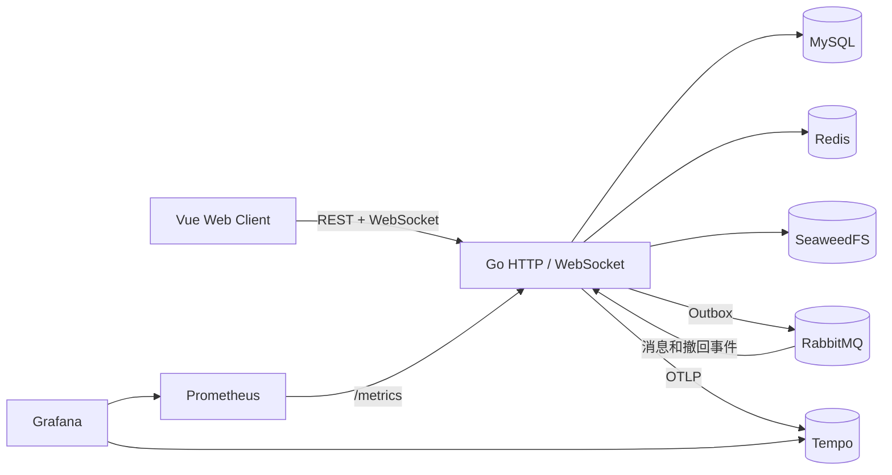

# RelayIM

RelayIM 是一个可以在浏览器中使用的即时通讯项目。后端使用 Go，前端使用 Vue 3，聊天记录和用户关系保存在 MySQL，Redis 负责缓存、限流、在线状态和多设备路由，RabbitMQ 负责异步消息投递。

目前已经覆盖日常聊天需要的主要流程：注册登录、好友申请、联系人和群成员资料、私聊、群聊、图片文件、历史记录、在线状态和已读回执。项目采用单仓库、模块化单体结构，本地可以通过 Docker Compose 完整启动。

## 功能

- **账号与设备**：支持注册、登录、Refresh Token 轮换、退出登录、独立设备标识和个人资料编辑。头像会保存到对象存储，WebSocket 使用短时一次性 Ticket 建连。
- **好友与联系人**：发送好友申请时必须填写理由；收到申请后可以同意或拒绝。好友支持独立备注、拉黑、单向删除，以及删除后重新申请。联系人资料页可以发私聊或邀请对方加入有管理权限的群。
- **私聊**：每个用户对只建立一个私聊会话。聊天页支持文本、图片、普通文件、消息撤回、送达 ACK 和会话已读位置。
- **群聊**：群主和普通成员都使用同一个会话模型。群主可以设置管理员、修改群资料、转让群主和解散群；管理员可以邀请或移除普通成员。
- **群邀请审批**：邀请时必须填写备注，受邀者同意时可以回复说明。被邀请人接受后才进入群，邀请支持过期、拒绝、取消和历史记录查询。
- **联系人工作区**：左侧显示好友、申请和拉黑列表，右侧显示当前联系人资料。群聊顶部成员和完整成员列表都可以点开资料；好友显示“发私聊”，非好友或关系已失效时显示“申请添加好友”。
- **消息同步**：同一会话使用连续 `seq` 排序。客户端重试不会重复创建消息；断线重连先拉最新页，历史由客户端主动翻页，发现序号缺口时使用 `after_seq` 补拉。
- **搜索与列表**：支持会话标题搜索、个人置顶、聊天记录搜索和游标分页。消息正文搜索支持 1 个字符的查询。
- **在线状态**：Redis 保存多设备在线状态，聊天页可以查看私聊对方状态或群内在线人数。
- **媒体与文件**：图片和文件最大 25 MB，保存在 SeaweedFS 的 S3 兼容存储中。下载地址使用短时签名，访问前校验会话成员和附件归属。

## 快速启动

推荐直接启动完整容器。需要先安装 Docker Desktop，并确保 Docker Engine 正常运行。

```powershell
Copy-Item deploy\.env.example deploy\.env
Copy-Item deploy\app.env.example deploy\app.env
```

打开两个文件，替换其中的数据库密码、JWT 密钥、RabbitMQ 密码和对象存储凭据。JWT 密钥至少需要 32 字节。

```powershell
docker compose `
  --env-file deploy\.env `
  --env-file deploy\app.env `
  -f deploy\docker-compose.yml `
  -f deploy\docker-compose.app.yml `
  up -d --build
```

启动完成后访问：

| 服务 | 地址 |
| --- | --- |
| Web 客户端 | http://localhost:8080 |
| Go API | http://localhost:8081 |
| RabbitMQ 管理界面 | http://localhost:15672 |
| Grafana | http://localhost:3000 |

第一次启动会构建前后端镜像并执行数据库迁移。需要演示数据时运行：

```powershell
.\scripts\seed-demo.ps1
```

脚本会在终端输出演示账号和密码。账号带有随机后缀，好友、私聊、群聊和撤回消息会一起创建。

## 本地开发

Go 和 Vue 也可以在本机运行，只把基础设施放进 Docker：

```powershell
docker compose --env-file deploy\.env -f deploy\docker-compose.yml up -d
Copy-Item internal\config\app.env.example internal\config\app.env
.\scripts\run-server.ps1
```

另开一个终端启动前端：

```powershell
Set-Location web
npm ci
npm run dev
```

开发地址是 `http://127.0.0.1:5173`。本机数据库初始化、迁移和完整配置说明见 [数据库开发指南](docs/数据库开发指南.md) 和 [配置管理指南](docs/配置管理指南.md)。

## 消息链路



发送一条消息时，服务端依次完成：

```text
HTTP 请求
  -> MySQL 事务写入 message、last_seq 和 outbox_event
  -> Outbox Worker 发布到 RabbitMQ
  -> Consumer 幂等处理事件
  -> 在线设备通过 WebSocket 接收
  -> 客户端提交送达 ACK 和已读游标
```

接口返回成功表示消息和 Outbox 已经在同一个 MySQL 事务中提交，并不表示 RabbitMQ 已经完成投递。实时投递采用至少一次语义，客户端按 `message_id` 去重，最终顺序以会话内 `seq` 为准。

## 技术栈

| 层面 | 技术 |
| --- | --- |
| 后端 | Go 1.26.11、Gin、GORM |
| 数据库 | MySQL 8.0 |
| 缓存与限流 | Redis 7.4、Lua、ZSET 滑动窗口 |
| 消息队列 | RabbitMQ 4.3、amqp091-go、Quorum Queue、DLQ |
| 对象存储 | SeaweedFS、S3 兼容接口、MinIO Go SDK |
| 前端 | Vue 3、TypeScript、Vite、Pinia、Vue Router |
| 可观测性 | OpenTelemetry、Tempo、Prometheus、Grafana、slog |
| 部署 | Docker 多阶段构建、Nginx、Docker Compose |
| 测试与压测 | Go test、Playwright、k6、GitHub Actions |

## 质量检查

```powershell
go vet ./...
golangci-lint run ./...
go test ./...
go test -race ./...
go run golang.org/x/vuln/cmd/govulncheck@v1.9.0 ./...

Set-Location web
npm audit --audit-level=high
npm run typecheck
npm run test:unit
npm run build
```

真实依赖集成测试使用以下环境变量：

```text
RELAYIM_TEST_MYSQL_DSN
RELAYIM_TEST_REDIS_ADDR
RELAYIM_TEST_REDIS_PASSWORD
RELAYIM_TEST_RABBITMQ_URL
RELAYIM_TEST_S3_ENDPOINT
RELAYIM_TEST_S3_ACCESS_KEY
RELAYIM_TEST_S3_SECRET_KEY
```

常用浏览器验收脚本：

| 脚本 | 验证内容 |
| --- | --- |
| `http-boundary-e2e.py` | 认证、非法 ID、长度边界、幂等、分页、拉黑和重新申请 |
| `latest-first-e2e.py` | 最新页、历史翻页、实时消息和断线恢复 |
| `social-ux-e2e.py` | 联系人资料、群成员资料、好友重申请和单向删除 |
| `friend-block-e2e.py` | 拉黑、消息和申请拦截、取消拉黑 |
| `friend-request-reason-e2e.py` | 好友申请理由必填 |
| `friendship-pagination-e2e.py` | 好友、申请和拉黑列表分页 |
| `conversation-pagination-e2e.py` | 会话复合游标分页和定时对账 |
| `conversation-search-pin-e2e.py` | 会话搜索和个人置顶 |
| `message-history-search-e2e.py` | 聊天记录面板和消息搜索 |
| `profile-avatar-e2e.py` | 头像上传、保留和移除 |
| `attachment-size-limit-e2e.py` | 附件大小和空文件校验 |
| `group-invitation-e2e.py` | 群邀请审批、取消、实时通知和历史记录 |
| `otel-trace-e2e.py` | HTTP 到消息消费的 Trace 链路 |

执行示例：

```powershell
python scripts\social-ux-e2e.py
python scripts\http-boundary-e2e.py
python scripts\latest-first-e2e.py
```

## 实测结果

以下数据来自本机 Docker 环境，用于功能回归和性能基线，不代表生产集群容量。

| 场景 | 结果 |
| --- | --- |
| HTTP 消息长稳 | 20 个独立发送账号、30 分钟发送 35,140 条，P95 41.91 ms，P99 55.27 ms |
| HTTP 消息容量 | 40 个独立发送账号、2 分钟发送 4,680 条，约 39 条/秒，P95 46.80 ms |
| WebSocket 群投递 | 4 个在线接收端，23 条消息产生 92 次投递，P95 500 ms，P99 545 ms |
| WebSocket 空闲连接 | 5,000 个连接完整重叠，建连成功率 99.90% |
| 300 人同群突发 | 300 条同秒发送全部 Accepted，300 个在线连接完整收到 90,000 次投递，端到端 P99 6.66 秒 |
| Ticket 限流 | 同一用户 20 并发时按配额返回 `429`，窗口恢复后重新放行 |
| 基础设施恢复 | RabbitMQ、Redis、MySQL 恢复后均重新可用，恢复约 11–13 秒 |

WebSocket 投递的 P95 当前正好落在 500 ms，与 Outbox 默认 500 ms 轮询间隔一致。功能检查全部通过，但严格阈值 `P95 < 500 ms` 仍需要调整轮询策略后再验证。

完整报告：

- [代码审查与异常压测](loadtest/reports/audit-2026-11-11.md)
- [30 分钟长稳、容量与故障注入](loadtest/reports/soak-fault-2026-11-12.md)
- [300 人同群瞬时容量](loadtest/reports/group-capacity-2026-11-12.md)
- [HTTP 消息基线](loadtest/reports/http-baseline.md)
- [WebSocket 投递基线](loadtest/reports/websocket-baseline.md)
- [WebSocket 连接阶梯](loadtest/reports/websocket-connections.md)
- [两实例实时投递](loadtest/reports/two-instance-e2e.md)

## 目录

```text
cmd/server/        服务入口
internal/          HTTP、WebSocket 和业务模块
migrations/        MySQL Goose 迁移
web/               Vue 3 前端
deploy/            Docker Compose、Nginx 和监控配置
loadtest/          k6 脚本与实测报告
docs/              产品、接口、数据库和运维文档
scripts/           演示数据与浏览器验收脚本
```

主要文档：

- [需求文档](docs/需求文档.md)
- [认证接口](docs/认证接口.md)
- [好友接口](docs/好友接口.md)
- [会话接口](docs/会话接口.md)
- [消息接口](docs/消息接口.md)
- [WebSocket 协议](docs/WebSocket协议.md)
- [RabbitMQ 可靠消息](docs/RabbitMQ可靠消息.md)
- [多实例实时投递](docs/多实例实时投递.md)
- [数据库开发指南](docs/数据库开发指南.md)
- [可观测性](docs/可观测性.md)
- [OpenAPI YAML](docs/openapi.yaml)

## 当前边界

- 支持两实例实时投递，但 CI 尚未自动启动两实例执行故障切换。
- 还没有举报审核和后台管理系统。
- 媒体链路支持图片和文件，没有缩略图、断点续传、病毒扫描和内容审核。
- 已完成 5,000 空闲连接、30 分钟消息长稳、300 人同群瞬时发送和基础设施故障注入；长稳场景尚未同时保持 5,000 个活跃 WebSocket 收发。
