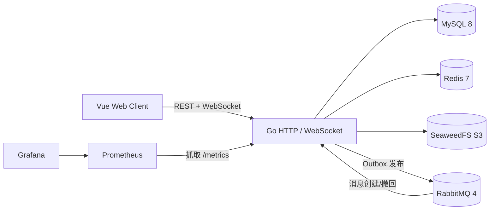

# GinChat

GinChat 是一个面向工程实践的即时通讯项目。项目保留单体应用的开发效率，同时实现了可靠消息、一次性 WebSocket Ticket、消息幂等、断线补拉、对象存储、限流和 Prometheus 观测等生产环境常见能力。

当前目标是做出可演示、可复现、可解释的单机 Web IM，并在后续阶段补齐全链路 Trace、两实例实时路由和更完整的故障注入。

## 已实现能力

- 账号注册、登录、Refresh Token 原子轮换、服务端退出登录。
- 个人昵称、头像和个人简介编辑。
- 好友申请、接受、拒绝、好友备注和私聊创建。
- 私聊与群聊统一会话模型，群成员、管理员、群主权限矩阵。
- 群主可以修改群名称、群头像、转让群主或解散群。
- 文本、图片和普通文件消息。
- 消息幂等、会话内连续 `seq`、历史分页和断线 `after_seq` 补拉。
- WebSocket 单写协程、有界队列、送达 ACK、已读游标和慢连接隔离。
- Redis 多设备在线状态、批量查询和前端在线人数展示。
- Redis 实例路由与 RabbitMQ 节点队列，支持跨 Go 实例 WebSocket 投递。
- 消息撤回、群主转让和群解散。
- Outbox + RabbitMQ Publisher Confirm + 手动 ACK + TTL 重试 + DLQ。
- Snowflake 启动时间水位校验，小幅时钟回拨等待、大幅回拨拒绝启动。
- 注册、登录、好友申请、消息发送、消息撤回和附件上传滑动窗口限流。
- SeaweedFS S3 兼容附件存储、短时预签名访问和附件归属校验。
- Prometheus 指标、健康检查、请求 ID、结构化日志和 Grafana 面板。
- Vue 3 + TypeScript 演示前端，覆盖核心聊天流程。

## 架构



核心消息链路：

```text
HTTP 发送
  -> MySQL 事务：message + last_seq + outbox
  -> Outbox Worker
  -> RabbitMQ
  -> Consumer 幂等处理
  -> 本实例在线 WebSocket 扇出
  -> 客户端 ACK / Read
```

接口成功只表示消息和 Outbox 已经提交，不宣称 RabbitMQ Exactly Once。实时链路采用至少一次投递，消息顺序以会话内 `seq` 为准，客户端按 `message_id` 去重。

## 技术栈

| 层级 | 技术 |
| --- | --- |
| 后端 | Go 1.25、Gin、GORM |
| 数据库 | MySQL 8.0 |
| 缓存与限流 | Redis 7.4、Lua + ZSET 滑动窗口 |
| 消息队列 | RabbitMQ 4.3、amqp091-go |
| 对象存储 | SeaweedFS S3 兼容接口、MinIO Go SDK |
| 可观测性 | Prometheus、Grafana、slog、Request ID |
| 前端 | Vue 3、TypeScript、Vite、Pinia、Vue Router |
| 压测 | k6 |
| 质量门禁 | GitHub Actions、go vet、go test、race、vue-tsc、Vite build |

## 快速启动

### 1. 启动基础设施

```powershell
Copy-Item deploy\.env.example deploy\.env
docker compose --env-file deploy\.env -f deploy\docker-compose.yml up -d
```

默认启动 RabbitMQ、Redis、SeaweedFS、Prometheus 和 Grafana。MySQL 使用本机已有实例，不要求重装。

### 2. 初始化数据库

```powershell
go install github.com/pressly/goose/v3/cmd/goose@v3.24.3
goose -dir migrations mysql "root:你的密码@tcp(127.0.0.1:3306)/ginchat_v2?charset=utf8mb4&parseTime=true&loc=UTC" up
```

数据库字段、索引和约束说明见 [数据库开发指南](docs/数据库开发指南.md)。

### 3. 配置并启动后端

```powershell
Copy-Item internal\config\app.env.example internal\config\app.env
.\scripts\run-server.ps1
```

本地配置不会提交 Git。至少需要填写 MySQL、JWT、Redis、RabbitMQ 和 S3 凭据，具体变量见 [配置管理指南](docs/配置管理指南.md)。

### 4. 启动前端

```powershell
Set-Location web
npm ci
npm run dev
```

打开 `http://127.0.0.1:5173`。

如需一键生成演示账号、好友、私聊、群聊、管理员和撤回消息：

```powershell
.\scripts\seed-demo.ps1
```

脚本会输出四个演示账号和统一本地密码，不会把 Token 写入磁盘。

## 质量检查

```powershell
git diff --name-only -- "*.go" | ForEach-Object { gofmt -w $_ }
go vet ./...
go test ./...
go test -race ./internal/messaging ./internal/ws ./internal/platform/ratelimit
Set-Location web
npm run typecheck
npm run build
```

启用真实依赖的 Go 集成测试需要：

```text
GINCHAT_TEST_MYSQL_DSN
GINCHAT_TEST_REDIS_ADDR
GINCHAT_TEST_REDIS_PASSWORD
GINCHAT_TEST_RABBITMQ_URL
GINCHAT_TEST_S3_ENDPOINT
GINCHAT_TEST_S3_ACCESS_KEY
GINCHAT_TEST_S3_SECRET_KEY
```

GitHub Actions 会在 PR 和主分支提交上执行后端静态检查、真实依赖集成测试、竞态检查前端类型检查和生产构建。

## 实测基线

以下数字来自本机实测，测试环境、脚本、原始摘要和已知限制均在报告中，不把单机结果表述为生产容量。

| 场景 | 结果 |
| --- | --- |
| HTTP 消息发送 | 10 VU、30 秒，2,696 条成功，89.04 req/s，P95 15.25 ms，P99 40.67 ms |
| WebSocket 群投递 | 20 个在线接收者，114 条消息，2,280 次投递，P95 482 ms，P99 500 ms |
| WebSocket 空闲连接 | 5,000 连接完整重叠，建连成功率 99.90%，服务端连接峰值 5,000 |
| Ticket 限流 | 同一用户 20 并发，10 次成功、10 次 `429`，窗口恢复后重新放行 |

报告：

- [HTTP 消息基线](loadtest/reports/http-baseline.md)
- [WebSocket 投递基线](loadtest/reports/websocket-baseline.md)
- [WebSocket 连接阶梯](loadtest/reports/websocket-connections.md)
- [Ticket 限流验证](loadtest/reports/ticket-rate-limit.md)
- [两实例实时投递验证](loadtest/reports/two-instance-e2e.md)

## 目录

```text
cmd/server/        服务入口
internal/          业务模块与基础设施适配
migrations/        MySQL Goose 迁移
web/               Vue 3 前端
deploy/            Docker Compose、Prometheus 和 Grafana
loadtest/          k6 脚本与实测报告
docs/              需求、协议、数据库和运维文档
```

## 关键文档

- [需求文档](docs/需求文档.md)
- [数据库开发指南](docs/数据库开发指南.md)
- [认证接口](docs/认证接口.md)
- [好友接口](docs/好友接口.md)
- [会话接口](docs/会话接口.md)
- [消息接口](docs/消息接口.md)
- [WebSocket 协议](docs/WebSocket协议.md)
- [在线状态](docs/在线状态.md)
- [多实例实时投递](docs/多实例实时投递.md)
- [雪花 ID 与时钟回拨](docs/雪花ID与时钟回拨.md)
- [OpenAPI 接口契约](docs/OpenAPI指南.md)
- [OpenAPI YAML](docs/openapi.yaml)
- [OpenAPI JSON](docs/openapi.json)
- [RabbitMQ 可靠消息](docs/RabbitMQ可靠消息.md)
- [可观测性](docs/可观测性.md)
- [接口限流](docs/接口限流.md)

## 当前边界

- 已支持两实例实时投递；当前 CI 仍未自动启动两实例，故障切换和长时间稳定性需要继续补测。
- 尚未接入 OpenTelemetry Trace、举报审核和后台管理系统。
- 对象存储已控制普通成员访问，但孤儿附件定时清理和病毒扫描尚未实现。

