# RelayIM

RelayIM 是一个面向浏览器场景的即时通讯项目，覆盖账号、好友、私聊、群聊、群治理、图片文件、已读回执、多设备在线状态和实时消息恢复。后端使用 Go，前端使用 Vue 3，消息数据保存在 MySQL，Redis 负责在线状态和限流，RabbitMQ 负责异步投递，SeaweedFS 保存图片与文件。

项目重点解决即时通讯里最容易被忽略、也最常被追问的三个问题：

- 消息在网络抖动、延迟和乱序到达时，如何保持会话内顺序。
- 消息已经写入数据库，但实时推送失败时，如何可靠补偿。
- 高并发群聊产生瞬时扇出时，如何避免慢连接拖垮整个服务。

## 界面预览

<p align="center">
  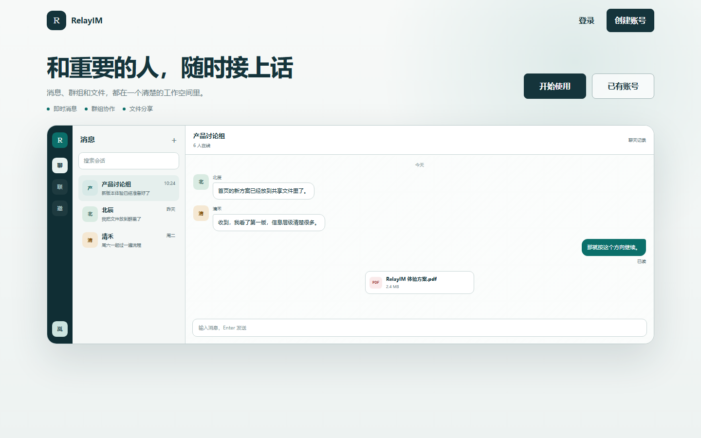
  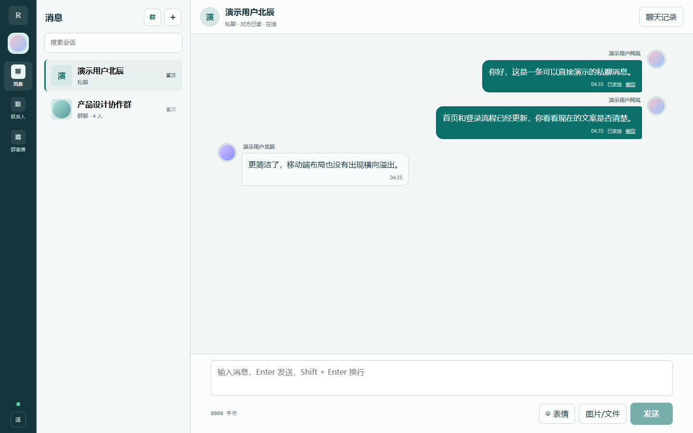
</p>
<p align="center">
  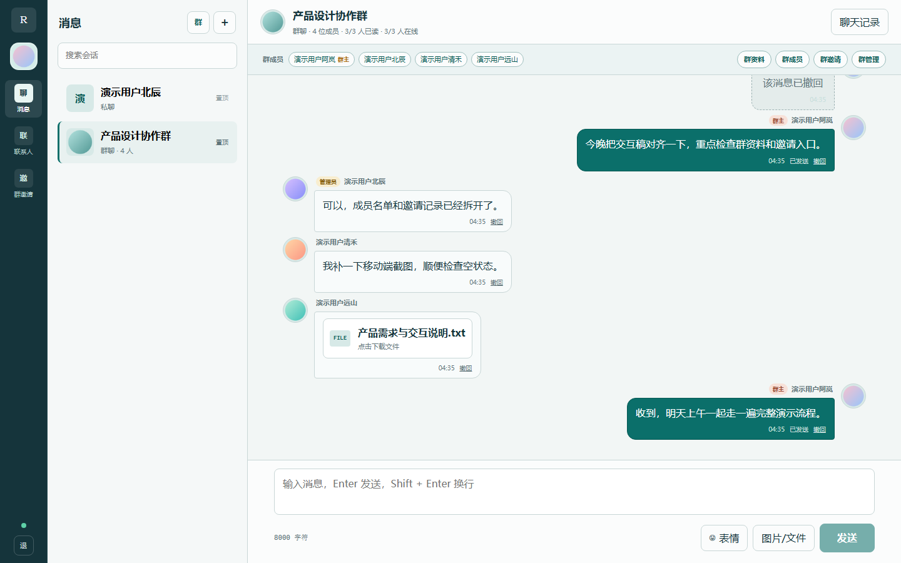
  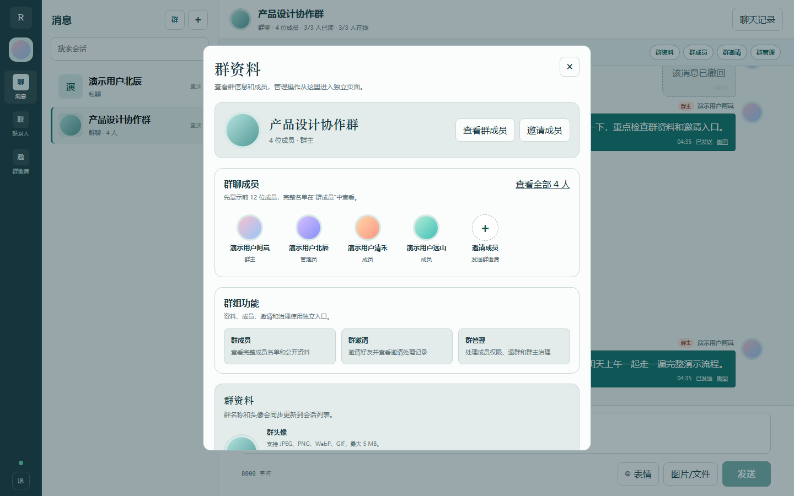
</p>

<details>
<summary>查看更多界面</summary>

<p align="center">
  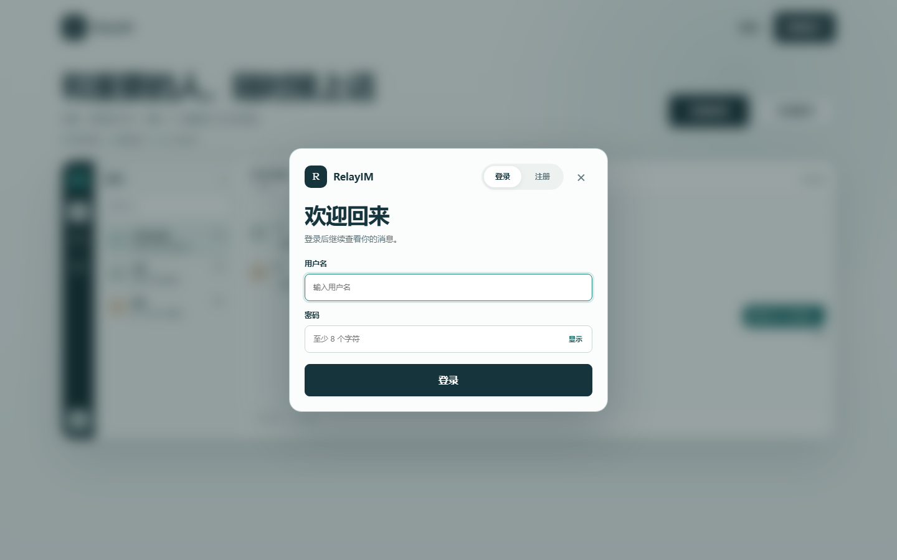
  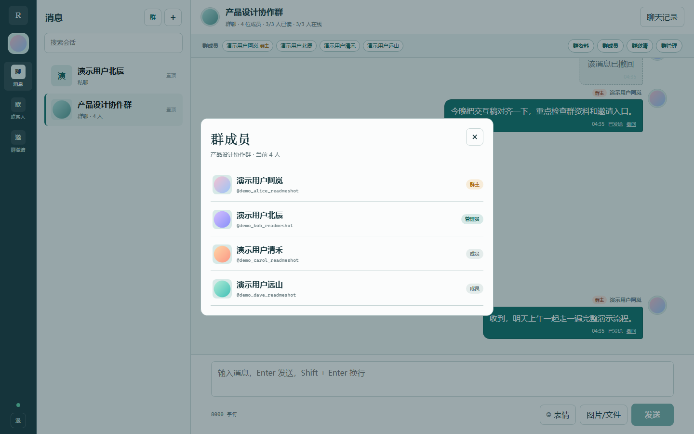
</p>
<p align="center">
  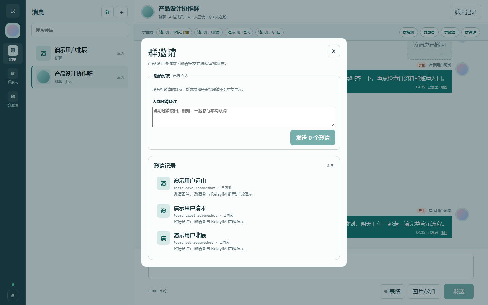
  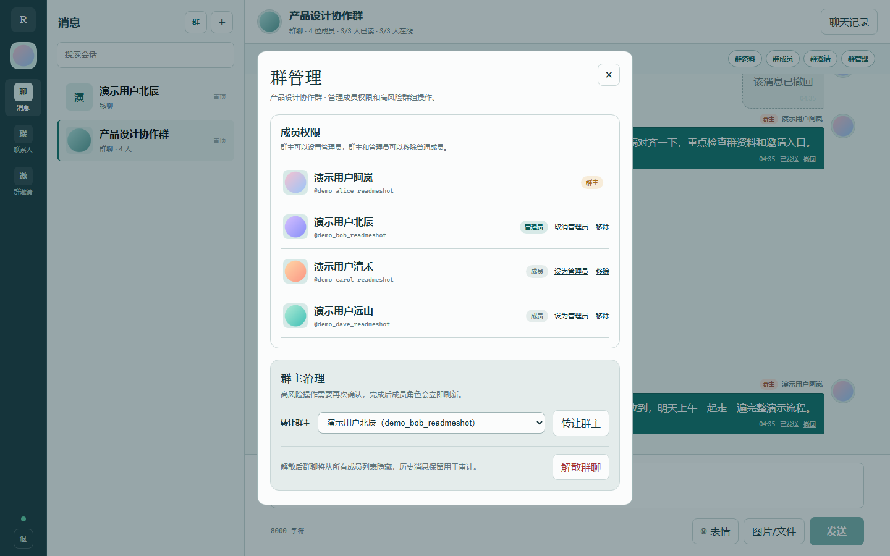
</p>
<p align="center">
  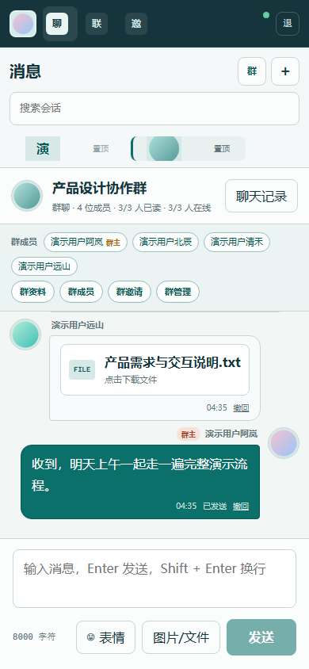
</p>

</details>

## 产品能力

- **账号与设备**：注册、登录、Refresh Token 轮换、设备标识、个人资料和对象存储头像。
- **好友与联系人**：好友申请理由、审批、备注、拉黑、单向删除，以及删除后的重新申请。
- **私聊与群聊**：文本、图片和文件消息，发送者头像与昵称，群主和管理员身份标识。
- **群组治理**：群资料、成员名单、群邀请、角色调整、成员移除、退群、群主转让和群解散使用独立入口。
- **消息体验**：会话搜索、会话置顶、聊天记录搜索、文件与图片列表、消息撤回、送达回执和已读位置。
- **实时通信**：WebSocket 使用一次性 Ticket 建连；Redis 保存多设备在线状态与跨实例路由。
- **消息恢复**：客户端断线重连后对齐最新窗口，发现序号缺口时主动补拉，历史记录按需向前翻页。
- **可观测性**：Prometheus、Grafana、Tempo 和 OpenTelemetry 展示请求、延迟、错误、Outbox、消费者和基础设施状态。

## 低时延与可靠性设计

### 消息延迟和乱序

消息不依赖网络到达顺序，也不使用客户端时间排序。

1. 服务端在事务内锁定会话行并递增 `last_seq`，每条消息获得严格递增的会话序号。
2. 客户端只维护连续水位，收到超前消息时先缓存，不能直接推进已读位置。
3. 发现缺口后使用 `after_seq` 补拉缺失区间，补洞完成后再推进连续水位。
4. 重复消息按 `message_id` 去重，晚到消息只更新缓存，不让游标倒退。
5. 最终展示顺序始终以服务端 `seq` 为准，而不是 WebSocket 帧到达时间。

因此，当第三条消息先到、前两条稍后到达时，界面不会先展示错误顺序，也不会漏掉中间消息。

### 可靠送达

消息发送和事件发布不做危险的“双写”：

```text
MySQL 事务
  -> 写入 message
  -> 更新 conversations.last_seq
  -> 写入 outbox_event
  -> 提交后返回 Accepted
```

Outbox Worker 在后台发布 RabbitMQ 事件。发布链路使用持久化消息、Publisher Confirm、手动 ACK、重试和死信队列。消息投递采用至少一次语义，Consumer 通过事件幂等记录避免重复处理，客户端再按 `message_id` 去重。

HTTP 返回成功表示消息已经持久化并且具备后续投递条件，不把“网络写入成功”误解成“对方已读”。

### 推送失败与离线恢复

- 在线推送失败不会回滚已经持久化的消息。
- 用户重新上线后先同步会话最新窗口，再通过连续序号检测断线期间是否漏消息。
- 缺失区间使用 `after_seq` 补齐；更早的历史由客户端使用 `before_seq` 分页加载。
- 已读位置按用户和会话保存，群聊不会用单一“群已读”状态覆盖其他成员。
- 同一账号的多台设备分别维护连接和送达回执。

### 高并发与慢连接

- WebSocket 每条连接只有一个写协程，业务协程通过有界队列提交写任务。
- 慢客户端只会影响自己的连接，不会阻塞全局广播。
- 群消息只保存一份正文，接收端通过会话成员关系完成扇出。
- 发送接口使用 Redis 滑动窗口进行用户级和全局限流，超限返回 `429` 与 `Retry-After`。
- RabbitMQ Consumer 使用有限 Worker 并行处理，并通过幂等表承受重放。

## 实测性能

以下数据来自当前单机 Docker 基准环境，测试对象是真实消息接口和完整消息链路，不是模拟函数调用。

| 场景 | 实测结果 |
| --- | --- |
| HTTP 消息长稳 | 20 个独立发送账号持续 30 分钟，完成 35,140 条，P95 41.91 ms，P99 55.27 ms，发送失败 0 |
| HTTP 消息常规容量 | 40 个独立发送账号持续 2 分钟，完成 4,680 条，约 39 条/秒，P95 46.80 ms |
| 90 人同群 QPS 峰值 | 30 秒成功写入 2,551 条，约 **82 QPS**，P95 803.28 ms，P99 956.69 ms |
| QPS 峰值稳定性 | HTTP 失败率 0，5xx 为 0，限流拒绝为 0 |
| Outbox 峰值承接 | pending 峰值约 2,552 条，压测后回落到 0，dead 为 0 |
| WebSocket 群投递 | 20 个在线接收端，114 条消息产生 2,280 次投递，P95 482 ms，P99 500 ms |
| WebSocket 空闲连接 | 5,000 个连接完整重叠，建连成功率 99.90%，握手 P95 6.22 ms |
| 300 人同群瞬时发送 | 300 条消息全部 Accepted，300 个连接完整收到 90,000 次投递，端到端 P99 6.66 秒 |
| 基础设施恢复 | RabbitMQ、Redis、MySQL 恢复后均重新可用，恢复约 11–13 秒 |

QPS 口径只统计返回 `201` 且包含服务端 `seq` 的成功消息写入。90 人群场景中，每条消息还会经过 Outbox、RabbitMQ 和群成员扇出链路。完整过程与原始数据见 [HTTP 消息 QPS 报告](loadtest/reports/http-qps-2026-11-15.md) 和 [性能与容量验收](docs/性能与容量验收.md)。

## 可观测性

Grafana 面板覆盖从请求进入到异步投递完成的主要观测点：

- HTTP 请求速率、消息发送接口 P95 和 5xx 错误率
- WebSocket 连接、处理中请求、MySQL 连接池和 Go 运行时
- 消息 Accepted 速率、Outbox pending/processing/dead 和附件上传
- 消费者成功率、死信率、处理耗时和事件积压延迟
- 限流拒绝速率
- OpenTelemetry Trace 通过 Tempo 串联 HTTP 请求、Outbox 事件和 Consumer

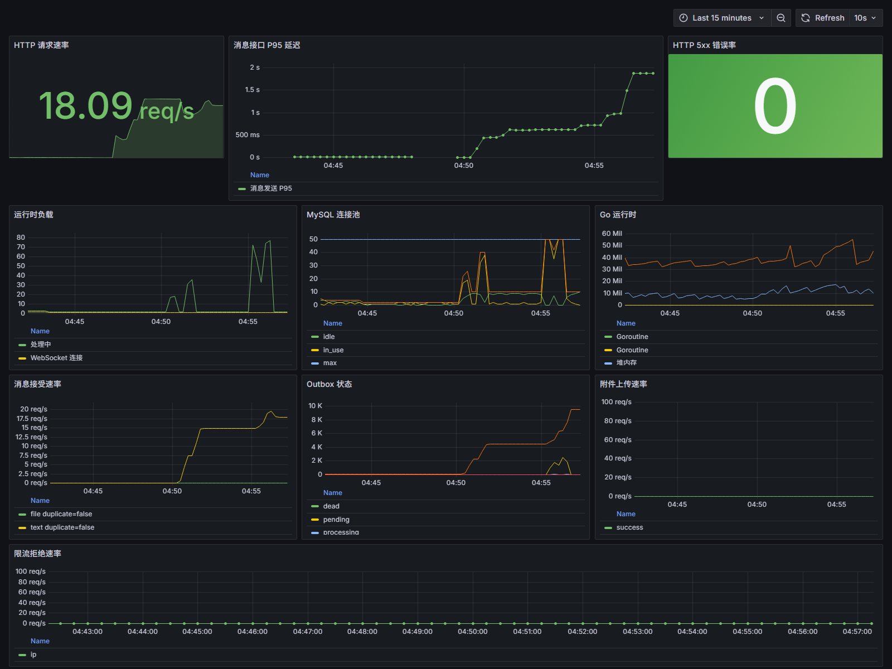

## 消息链路

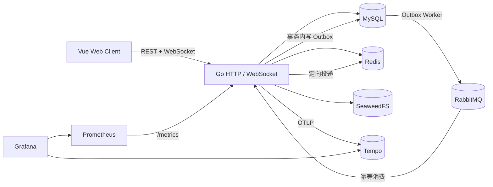

## 快速启动

推荐由本机 MySQL 保存业务数据，Docker 负责 Go 后端、Vue 前端、Redis、RabbitMQ、SeaweedFS 和监控组件。

先创建数据库：

```sql
CREATE DATABASE relayim
  CHARACTER SET utf8mb4
  COLLATE utf8mb4_0900_ai_ci;
```

准备容器配置：

```powershell
Copy-Item deploy\.env.example deploy\.env
Copy-Item deploy\app.env.example deploy\app.env
```

填写 MySQL 密码、JWT 密钥、RabbitMQ 密码和对象存储凭据。MySQL 密码优先使用 `RELAYIM_MYSQL_PASSWORD`，JWT 密钥至少 32 字节。

启动完整环境：

```powershell
docker compose `
  --env-file deploy\.env `
  --env-file deploy\app.env `
  -f deploy\docker-compose.yml `
  -f deploy\docker-compose.app.yml `
  up -d --build --remove-orphans
```

代码更新后同样使用带 `--build` 的命令，避免复用旧镜像。

启动完成后访问：

| 服务 | 地址 |
| --- | --- |
| Web 客户端 | http://127.0.0.1:8080 |
| Go API | http://127.0.0.1:8081 |
| 本机 MySQL | `127.0.0.1:3306` |
| RabbitMQ 管理界面 | http://127.0.0.1:15672 |
| Prometheus | http://127.0.0.1:9090 |
| Grafana | http://127.0.0.1:3000 |
| Tempo | http://127.0.0.1:3200 |

需要演示数据时运行：

```powershell
.\scripts\seed-demo.ps1
```

[演示数据脚本](scripts/seed-demo.ps1) 会创建好友、私聊、群聊、管理员、撤回消息和邀请记录，并输出本次演示账号。

## 本地开发

Docker 只启动基础设施时：

```powershell
docker compose --env-file deploy\.env -f deploy\docker-compose.yml up -d
Copy-Item internal\config\app.env.example internal\config\app.env
.\scripts\run-server.ps1
```

另开终端启动前端：

```powershell
Set-Location web
npm ci
npm run dev
```

开发地址为 `http://127.0.0.1:5173`。Redis 默认映射到宿主机 `6380`。配置、迁移和数据库说明见 [配置管理指南](docs/配置管理指南.md) 与 [数据库开发指南](docs/数据库开发指南.md)。

## 技术栈

| 层面 | 技术 |
| --- | --- |
| 后端 | Go 1.26.11、Gin、GORM |
| 数据库 | MySQL 8.0 |
| 缓存与限流 | Redis 7.4、Lua、ZSET 滑动窗口 |
| 消息队列 | RabbitMQ 4.3、amqp091-go、Quorum Queue、DLQ |
| 对象存储 | SeaweedFS、S3 兼容接口、MinIO Go SDK |
| 前端 | Vue 3、TypeScript、Vite、Pinia、Vue Router |
| 可观测性 | OpenTelemetry、Tempo、Prometheus、Grafana、slog |
| 部署 | Docker 多阶段构建、Nginx、Docker Compose |
| 测试与压测 | Go test、Playwright、k6、GitHub Actions |

## 质量检查

```powershell
go vet ./...
golangci-lint run ./...
go test ./...
go test -race ./...
go run golang.org/x/vuln/cmd/govulncheck@v1.9.0 ./...

Set-Location web
npm audit --audit-level=high
npm run typecheck
npm run test:unit
npm run build
```

真实依赖集成测试使用以下环境变量：

```text
RELAYIM_TEST_MYSQL_DSN
RELAYIM_TEST_REDIS_ADDR
RELAYIM_TEST_REDIS_PASSWORD
RELAYIM_TEST_RABBITMQ_URL
RELAYIM_TEST_S3_ENDPOINT
RELAYIM_TEST_S3_ACCESS_KEY
RELAYIM_TEST_S3_SECRET_KEY
```

常用浏览器验收脚本：

| 脚本 | 验证内容 |
| --- | --- |
| `http-boundary-e2e.py` | 认证、非法 ID、长度边界、幂等、分页、拉黑和重新申请 |
| `latest-first-e2e.py` | 最新页、历史翻页、实时消息和断线恢复 |
| `social-ux-e2e.py` | 联系人资料、群成员资料、好友重申请和单向删除 |
| `friend-block-e2e.py` | 拉黑、消息和申请拦截、取消拉黑 |
| `friend-request-reason-e2e.py` | 好友申请理由必填 |
| `friendship-pagination-e2e.py` | 好友、申请和拉黑列表分页 |
| `conversation-pagination-e2e.py` | 会话复合游标分页和定时对账 |
| `conversation-search-pin-e2e.py` | 会话搜索和个人置顶 |
| `message-history-search-e2e.py` | 聊天记录面板和消息搜索 |
| `profile-avatar-e2e.py` | 头像上传、保留和移除 |
| `message-avatar-e2e.py` | 私聊与群聊头像、群资料、成员、邀请、管理和响应式布局 |
| `attachment-size-limit-e2e.py` | 附件大小和空文件校验 |
| `group-invitation-e2e.py` | 群邀请审批、取消、实时通知和历史记录 |
| `otel-trace-e2e.py` | HTTP 到消息消费的 Trace 链路 |

执行示例：

```powershell
python scripts\message-avatar-e2e.py
python scripts\group-invitation-e2e.py
python scripts\latest-first-e2e.py
```

## 压测入口

HTTP 消息基线：

```powershell
docker run --rm `
  --add-host=host.docker.internal:host-gateway `
  -e BASE_URL=http://host.docker.internal:8081 `
  -e VUS=40 `
  -e DURATION=2m `
  -e SLEEP_SECONDS=1 `
  -v "${PWD}:/work" `
  -w /work `
  grafana/k6:0.57.0 run loadtest/k6/http-message.js
```

90 人同群 QPS：

```powershell
go run .\loadtest\cmd\groupfixture `
  -members 90 `
  -output .tmp\group-capacity-qps.json

docker run --rm `
  --add-host=host.docker.internal:host-gateway `
  -e BASE_URL=http://host.docker.internal:8081 `
  -e FIXTURE_FILE=../../.tmp/group-capacity-qps.json `
  -e VUS=90 `
  -e DURATION=30s `
  -e SLEEP_SECONDS=0.4 `
  -e SUMMARY_FILE=http-qps-90-saturated.json `
  -v "${PWD}:/work" `
  -w /work `
  grafana/k6:0.57.0 run loadtest/k6/http-qps.js
```

完整压测命令、清理方式和指标口径见 [压测说明](loadtest/README.md) 与 [压测报告索引](loadtest/reports/README.md)。

## 目录

```text
cmd/server/        服务入口
internal/          HTTP、WebSocket 和业务模块
migrations/        MySQL Goose 迁移
web/               Vue 3 前端
deploy/            Docker Compose、Nginx 和监控配置
loadtest/          k6 脚本与实测报告
docs/              产品、接口、数据库和运维文档
scripts/           演示数据与浏览器验收脚本
```

主要文档：

- [需求文档](docs/需求文档.md)
- [认证接口](docs/认证接口.md)
- [好友接口](docs/好友接口.md)
- [会话接口](docs/会话接口.md)
- [消息接口](docs/消息接口.md)
- [附件消息](docs/附件消息.md)
- [WebSocket 协议](docs/WebSocket协议.md)
- [RabbitMQ 可靠消息](docs/RabbitMQ可靠消息.md)
- [多实例实时投递](docs/多实例实时投递.md)
- [接口限流](docs/接口限流.md)
- [数据库开发指南](docs/数据库开发指南.md)
- [可观测性](docs/可观测性.md)
- [性能与容量验收](docs/性能与容量验收.md)
- [演示指南](docs/演示指南.md)
- [演示截图说明](docs/media/demo/README.md)
- [OpenAPI YAML](docs/openapi.yaml)

## 后续路线

- 语音与视频消息
- 举报审核与运营管理后台
- 图片缩略图、断点续传和附件安全扫描
- 多地域部署与更细粒度的容量调度
