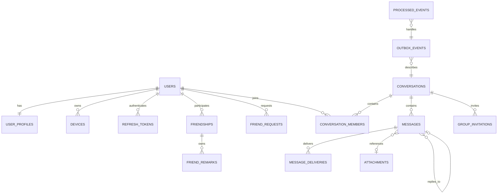

# GinChat 数据库开发指南

| 项目 | 内容 |
| --- | --- |
| 目标数据库 | MySQL 8.0.34 |
| 数据库名 | `ginchat_v2` |
| 迁移工具 | goose v3.24.3 |
| 当前迁移版本 | 7 |
| 当前业务表 | 16 张 |
| 字符集与排序规则 | `utf8mb4` / `utf8mb4_0900_ai_ci` |
| 存储引擎 | InnoDB |
| 本文用途 | 后续 Go 模型、Repository、Service、测试和协议开发的数据库约束参考 |

详细 DDL 见：

- [身份与社交迁移](../migrations/00001_identity_and_social.sql)
- [会话与消息迁移](../migrations/00002_conversation_and_message.sql)
- [可靠消息迁移](../migrations/00003_reliable_messaging.sql)
- [附件原始文件名迁移](../migrations/00004_attachment_filename.sql)
- [附件唯一绑定迁移](../migrations/00005_unique_attachment_binding.sql)
- [用户拉黑迁移](../migrations/00006_user_blocks.sql)
- [好友分页索引迁移](../migrations/00007_friendship_pagination_indexes.sql)
- [数据库设计草案](./数据库设计.md)

## 1. 设计目标

数据库服务于以下业务：

- 多设备登录与账号状态。
- 好友申请、好友关系、双方独立备注和方向性拉黑。
- 私聊与群聊统一会话。
- 文本、图片和文件消息。
- 引用回复、撤回、设备送达和会话已读。
- 断线重连和按会话序号补拉。
- MySQL Outbox 到 RabbitMQ 的可靠异步分发。
- 至少一次消费下的幂等处理。

旧 `ginchat` 数据不迁移。`ginchat_v2` 已由 goose 从空库初始化。

## 2. 基础约定

### 2.1 ID

- 业务主键使用应用生成的 Snowflake 正整数，数据库中为 `BIGINT UNSIGNED`。
- 不使用 MySQL `AUTO_INCREMENT` 生成用户、会话和消息业务 ID。
- `outbox_events.id` 使用自增，仅作为发布扫描游标。
- `outbox_events.event_id` 使用 Snowflake，作为 RabbitMQ 幂等事件 ID。

Snowflake 只保证全局唯一和近似时间有序。会话内消息顺序使用 `messages.seq`。

Go 和前端之间传递以下 ID 时必须转换为字符串：

```text
user_id
device_id
conversation_id
message_id
attachment_id
event_id
```

原因：Snowflake 可能超过 JavaScript 的 `Number.MAX_SAFE_INTEGER`。

### 2.2 时间

- 数据库使用 `DATETIME(3)`，精确到毫秒。
- 应用层统一按 UTC 生成和解释时间。
- 部署前应把 MySQL DSN 的 `loc` 配置从 `Local` 改为 `UTC`。
- 前端按用户时区格式化，不把本地时间重新写回数据库。

### 2.3 状态

状态字段使用整数和 `CHECK` 约束，不使用 MySQL `ENUM`。

原因：

- 迁移和 Go 常量映射更直接。
- 新增状态时不必重建 ENUM 类型。
- 非法值在数据库层仍会被拒绝。

## 3. 关系总览



## 4. 身份与社交表

### 4.1 `users`

保存登录身份和账号状态。

| 字段 | 含义 | 设计原因 |
| --- | --- | --- |
| `id` | Snowflake 用户 ID | 多实例可生成，避免自增冲突 |
| `username` | 登录名 | 唯一索引防止重复注册 |
| `password_hash` | 密码哈希 | 不保存明文密码 |
| `status` | 1 正常、2 禁用 | 账号可被管理 |
| `deleted_at` | 软删除时间 | 保留历史消息和关系引用 |
| `created_at/updated_at` | 时间戳 | 排序与审计基础 |

用户名软删除后不复用，避免历史身份产生歧义。

### 4.2 `user_profiles`

保存昵称、头像和简介。与 `users` 一对一。

认证字段与公开资料分表，API 查询资料时不容易误返回密码哈希和登录设备信息。

### 4.3 `devices`

保存用户设备、平台、最近活跃时间和撤销时间。

送达状态必须知道具体设备，因此多设备是数据库的一等模型。实时 Presence 存 Redis，不频繁更新此表。

### 4.4 `refresh_tokens`

保存 Refresh Token 的 SHA-256 哈希、设备和过期时间。

Token 明文只在签发时返回客户端，数据库只保留哈希。

### 4.5 `friendships`

一条记录表示一对好友，不保存正反两条：

```text
user_low_id < user_high_id
UNIQUE(user_low_id, user_high_id)
```

`status`：

```text
1 正常
2 已删除
```

重新添加好友时复用原记录并恢复状态。删除好友时 Service 必须在同一事务中删除双方备注。

### 4.6 `friend_remarks`

好友备注是方向性数据：

```text
PRIMARY KEY(friendship_id, user_id)
```

同一好友关系中，双方可以设置不同备注。数据库无法验证 `user_id` 是否属于好友对，Service 必须检查。

### 4.7 `friend_requests`

使用规范化用户对，并保存当前申请人：

```text
UNIQUE(user_low_id, user_high_id)
requester_id
```

状态：

```text
1 待处理
2 已同意
3 已拒绝
4 已撤回
```

同一用户对只保留一条申请。拒绝后重新申请时更新原记录。

### 4.8 `user_blocks`

拉黑关系保留发起方向：

```text
PRIMARY KEY(blocker_id, blocked_id)
```

`(blocked_id, blocker_id)` 索引支持反向关系检查，`(blocker_id, created_at)` 支持拉黑列表。任一方向存在拉黑时，好友申请、接受申请、创建私聊和发送私聊消息都必须拒绝；历史消息和群聊不受影响。

## 5. 会话与群组表

### 5.1 `conversations`

私聊和群聊共用一个会话模型。

私聊：

```text
conversation_type = 1
direct_low_user_id < direct_high_user_id
owner_id = NULL
UNIQUE(direct_low_user_id, direct_high_user_id)
```

群聊：

```text
conversation_type = 2
direct_low_user_id = NULL
direct_high_user_id = NULL
owner_id = 群主
```

`last_seq` 在发送事务中递增，是会话内消息序号的事实来源。

`last_message_id` 用于会话列表展示，但故意不建立外键，避免消息表和会话表形成循环引用。

`status`：

```text
1 正常
2 已归档
3 已解散
```

### 5.2 `conversation_members`

主键：

```text
(conversation_id, user_id)
```

字段职责：

| 字段 | 含义 |
| --- | --- |
| `role` | 1 成员、2 管理员、3 群主 |
| `joined_at` | 首次加入时间 |
| `left_at` | 退出时间，NULL 表示当前成员 |
| `last_read_seq` | 用户已读到的会话消息序号 |

未读数：

```text
max(conversations.last_seq - conversation_members.last_read_seq, 0)
```

已读使用游标而不是逐消息回执，避免群聊写入放大。

### 5.3 `group_invitations`

同一群对同一被邀请人只有一条邀请记录。

状态：

```text
1 待处理
2 已接受
3 已拒绝
4 已过期
5 已取消
```

重新邀请时更新原记录。过期任务需要同时检查 `status` 和 `expires_at`。

## 6. 消息与附件表

### 6.1 `attachments`

保存对象存储元数据，不保存文件二进制。

| 字段 | 含义 |
| --- | --- |
| `object_key` | SeaweedFS/S3 对象键，唯一 |
| `original_name` | 用户上传时的原始文件名，仅用于展示和下载名称 |
| `mime_type` | MIME 类型 |
| `size_bytes` | 文件大小 |
| `checksum_sha256` | 内容校验值 |
| `status` | 待确认、可用、阻止、删除 |
| `finalized_at` | 上传最终确认时间 |

当前使用单一 Bucket，Bucket 名由配置提供。未来支持多 Bucket 时再增加 `bucket_name` migration。

### 6.2 `messages`

| 字段 | 含义 | 设计原因 |
| --- | --- | --- |
| `id` | Snowflake 消息 ID | API 和前端全局定位 |
| `conversation_id` | 所属会话 | 不保存冗余接收者 |
| `seq` | 会话内序号 | 排序、补洞、未读游标 |
| `sender_id` | 发送者 | 权限和历史展示 |
| `client_msg_id` | 客户端幂等键 | 重试不重复插入 |
| `message_type` | 文本、图片、文件、音频 | 消息载荷类型 |
| `content` | 文本或说明 | 文本消息必须有非空内容 |
| `attachment_id` | 附件引用 | 媒体消息必须有附件 |
| `reply_to_message_id` | 引用消息 | 支持引用回复 |
| `metadata` | @提醒等扩展数据 | 避免为核心功能频繁加列 |
| `recalled_at` | 撤回时间 | 可追踪撤回状态 |
| `recalled_by` | 撤回用户 | 记录执行人 |

关键唯一约束：

```text
UNIQUE(conversation_id, seq)
UNIQUE(sender_id, client_msg_id)
UNIQUE(attachment_id)
```

没有 `receiver_id` 和全局消息状态：

- 接收范围来自会话成员。
- 送达来自 `message_deliveries`。
- 已读来自成员 `last_read_seq`。

撤回时数据库保留原内容用于审计和风控，API 对普通用户只返回撤回提示并隐藏内容。

### 6.3 `message_deliveries`

主键：

```text
(message_id, device_id)
```

表示某条消息已到达某个设备。重复 ACK 使用幂等 upsert，保留最早送达时间。

设备表只做软撤销，不删除历史设备，避免送达记录失去外键引用。

## 7. 可靠消息表

### 7.1 `outbox_events`

| 字段 | 含义 |
| --- | --- |
| `id` | MySQL 自增扫描游标 |
| `event_id` | Snowflake 业务事件 ID |
| `aggregate_type` | 聚合类型 |
| `aggregate_id` | 聚合 ID |
| `event_type` | 版本化事件名 |
| `payload` | 最小事件载荷 JSON |
| `status` | 待发布、处理中、已发布、死信 |
| `attempt_count` | 发布尝试次数 |
| `available_at` | 最早再次尝试时间 |
| `locked_by/locked_at` | 发布实例与租约 |
| `published_at` | RabbitMQ Confirm 成功时间 |
| `last_error` | 最近错误 |

约束要求：

- `status=2` 时 `published_at` 必须存在。
- 非已发布状态不能有 `published_at`。
- `locked_by` 和 `locked_at` 必须同时存在或同时为空。
- `status=1` 必须有租约字段。

事件载荷只保存消息 ID、会话 ID、seq 等最小信息。Consumer 需要正文时重新查询 MySQL，避免 MQ 中保存大段用户内容。

### 7.2 `processed_events`

主键：

```text
(event_id, consumer_name)
```

用于至少一次投递下的消费幂等。记录按保留策略定期清理，不能无限增长。

该表不是 Exactly Once 机制。真正的幂等仍依赖业务唯一约束和状态推进规则。

## 8. 数据库约束与 Service 责任

### 8.1 数据库保证

- 用户名唯一。
- `user_low_id < user_high_id`。
- 同一用户对唯一好友、申请和私聊。
- 会话内 `seq` 唯一。
- 同一发送者的 `client_msg_id` 唯一。
- 同一附件最多绑定一条消息。
- 同一设备对同一消息只有一条送达记录。
- 消息、邀请和 Outbox 状态合法。
- 文本消息内容非空且没有附件。
- 图片、文件、音频消息必须有附件。
- 消息不能引用自己。
- 撤回时间和撤回人成对存在。
- Outbox 发布状态与时间、租约字段一致。

### 8.2 Service 必须保证

- 好友备注用户属于对应好友关系。
- 私聊会话恰好有两个有效成员。
- 群主同时是群成员且角色为群主。
- 发送者属于目标会话。
- 引用消息属于同一会话。
- 被撤回消息由发送者或授权管理员操作。
- `last_read_seq` 不超过会话当前 `last_seq`。
- 附件属于发送者且状态可用。
- 附件消息类型与附件 MIME 匹配。
- 只有当前成员能读取会话和发送消息。
- 群邀请人具有邀请权限。
- Outbox 事件状态转换合法。

## 9. 核心事务

### 9.1 创建私聊

```text
BEGIN
规范化两个用户 ID
按唯一用户对尝试查找私聊
不存在则创建 conversations 和两个 conversation_members
COMMIT
```

并发创建通过唯一索引兜底，冲突后查询已存在会话。

### 9.2 发送消息

```text
BEGIN
检查发送者是否仍是会话成员
SELECT last_seq FROM conversations WHERE id = ? FOR UPDATE
seq = last_seq + 1
生成 Snowflake message_id 和 event_id
INSERT messages
UPDATE conversations.last_seq/last_message_id
INSERT outbox_events
COMMIT
```

接口只有在事务提交后返回 Accepted。

### 9.3 设备送达

```text
校验 device 属于当前用户
验证消息接收者属于会话
INSERT message_deliveries
ON DUPLICATE KEY 保留最早 delivered_at
```

### 9.4 推进已读

```text
UPDATE last_read_seq = GREATEST(last_read_seq, ?)
要求用户仍是会话成员
要求目标 seq 不超过会话当前 last_seq
```

### 9.5 Outbox 发布

```text
SELECT 可发布事件 FOR UPDATE SKIP LOCKED
设置 status=1 和租约
COMMIT
RabbitMQ Publish + Publisher Confirm
成功：status=2、published_at=now、清空租约
失败：增加次数、设置 available_at 或进入死信
```

## 10. 索引与访问路径

| 业务查询 | 主要索引 |
| --- | --- |
| 登录 | `uk_users_username` |
| 好友列表 | `idx_friendships_low_status_id` / `idx_friendships_high_status_id` |
| 双向拉黑检查 | `user_blocks` 主键 / `idx_user_blocks_blocked` |
| 拉黑列表 | `idx_user_blocks_blocker_created` |
| 我的会话 | `idx_members_user_active` |
| 历史消息 | `uk_messages_conversation_seq` |
| 客户端重试 | `uk_messages_sender_client` |
| 引用消息 | `idx_messages_reply_to` |
| 送达设备 | `idx_message_deliveries_device` |
| Outbox 领取 | `idx_outbox_claim` |
| 消费幂等 | `processed_events` 主键 |

不为消息正文建立普通 B-tree 索引。全文搜索需要单独评估 MySQL FULLTEXT 或搜索服务。

## 11. 当前已知限制

以下功能不在当前 migration 中，需要未来新增 migration：

- 会话置顶和免打扰时间。
- 消息 Emoji Reaction。
- 群公告与审计日志。
- 多 Bucket 附件。
- 消息全文搜索。
- 附件清理和消息归档任务。

不得通过直接修改已执行 migration 添加这些功能，应新增版本化 migration。

## 12. 迁移规范

- 数据库结构以 `migrations/*.sql` 为事实来源。
- 禁止使用 GORM `AutoMigrate` 修改正式表结构。
- 已执行 migration 不直接改写；修正使用新 migration。
- 新 migration 必须同时提供明确 Down。
- 开发验证执行 `up → status → down-to 0 → up`。
- DSN 和密码只能用于本地命令，不写入 Git。
- `ginchat_v2` 数据不得在无备份时全量回退。
