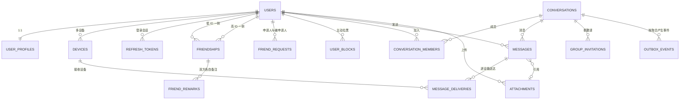

# RelayIM MySQL 数据库设计

| 项目 | 内容 |
| --- | --- |
| 文档版本 | v1.0 |
| 更新日期 | 2026-11-11 |
| 目标数据库 | MySQL 8.0.34（当前开发与部署基线） |
| 存储引擎 | InnoDB |
| 字符集 | `utf8mb4` |
| 排序规则 | `utf8mb4_0900_ai_ci` |
| 迁移工具 | `goose` v3.24.3 |
| 当前迁移版本 | 16 |
| 数据迁移策略 | 不迁移旧数据，在空库执行全部 migration |
| 本文档状态 | 仅设计，不改 Go 代码、不创建 migration、不执行数据库变更 |

## 1. 设计目标

本设计服务于以下核心业务：

- 用户注册、登录、多设备会话和资料管理。
- 好友申请、双向好友关系、双方独立好友备注。
- 私聊与群聊共用会话、成员、消息和已读语义。
- 服务端确认后的消息可靠持久化。
- 按设备记录送达，按用户会话游标记录已读。
- 消息与 Outbox 同事务提交，然后通过 RabbitMQ 异步分发。
- 断线重连后按会话 `seq` 补拉，不依赖离线消息副本。

当前没有必须保留的数据，因此只设计目标结构，不为旧表编写数据转换逻辑。

## 2. 数据库选型

建议继续使用 MySQL：

- 当前项目已使用 GORM MySQL Driver 和 MySQL DSN。
- 本项目需要的能力均可由 MySQL 8 提供：事务、行锁、`FOR UPDATE SKIP LOCKED`、唯一约束、CHECK、JSON 和复合索引。
- PostgreSQL 在 JSONB、部分索引和复杂查询方面更强，但当前业务没有必须依赖这些特性的场景。
- 继续使用 MySQL 能减少迁移成本，把精力放在消息一致性、RabbitMQ 和并发连接上。

当前开发与部署基线使用 MySQL 8.0.34。本文 SQL 只使用 MySQL 8.0.19+ 已支持的语法；未来只有在明确需要新版本特性或安全修复时才升级。

## 3. 业务关系



### 3.1 关系说明

1. 一个用户对应一条资料和多个设备。
2. 好友关系只保存一条对称记录，用较小的用户 ID 和较大的用户 ID 规范化这一对用户。
3. 好友备注是方向性数据，因此放在独立表；双方可以有不同备注。
4. 好友申请与好友关系是不同生命周期，分别存储。
5. 私聊和群聊统一属于 `conversations`，避免两套消息链路。
6. 用户通过 `conversation_members` 加入会话，成员表保存角色和已读游标。
7. 一条消息只保存一份正文，通过 `conversation_id` 关联会话，不为每个接收者复制正文。
8. 送达回执按 `message_id + device_id` 保存；已读只推进用户成员行的 `last_read_seq`。
9. 附件单独存储元数据，消息只引用 `attachment_id`。
10. Outbox 是业务事务和 RabbitMQ 发布之间的可靠桥梁。

## 4. 数据访问方式与容量假设

### 4.1 主要访问路径

| 访问场景 | 过滤条件 | 排序/分页 | 预期索引路径 |
| --- | --- | --- | --- |
| 登录 | `username` | 单条 | `uk_users_username` 唯一索引 |
| 查公开资料 | `id` | 单条 | 主键 |
| 查用户设备 | `user_id, revoked_at IS NULL` | 最近活跃 | `idx_devices_user_active` |
| 好友列表 | `user_low_id` 或 `user_high_id` | 关系更新时间倒序 | 两侧复合索引 + `UNION ALL` |
| 好友备注 | `friendship_id, user_id` | 单条 | 联合主键 |
| 好友申请 | 规范化用户对 | 单条或时间倒序 | 用户对唯一索引、申请人索引 |
| 会话列表 | 当前用户成员行 | 置顶优先、更新时间倒序 | `idx_members_user_active` + 会话主键 |
| 历史消息 | `conversation_id, seq` | `seq DESC LIMIT` | `uk_messages_conversation_seq` |
| 会话内消息搜索 | `conversation_id` + 全文匹配 | `seq DESC LIMIT` | `ft_messages_content` + 会话序号索引 |
| 群成员 | `conversation_id, left_at IS NULL` | 角色、加入时间 | 会话成员联合主键 |
| 逐设备送达 | `message_id, device_id` | 幂等 upsert | 联合主键 |
| Outbox 领取 | `status, available_at` | 时间、ID 顺序 | `idx_outbox_claim` |
| 消费幂等 | `event_id, consumer_name` | 单条 | 联合主键 |

### 4.2 规模假设

第一版按以下规模设计，不提前分区：

- 用户量：10 万以内。
- 群成员上限：500。
- 消息写入目标：200 条/秒以内。
- 会话内历史消息：单会话百万级以内。
- 消息保留：演示环境长期；生产目标 180 天。
- 在线连接：单实例 5,000；数据库不是连接保持层。

在达到单表 1,000 万级消息或出现明确慢查询后，再评估按月分区、归档表或冷热分离。当前不提前做分区和消息分库。

## 5. 表分组说明

### 5.1 身份与账号段

这一组负责“谁在使用系统、从什么设备登录、如何撤销登录、如何展示公开资料”。

| 表 | 作用 |
| --- | --- |
| `users` | 登录身份、密码哈希、账号状态和软删除 |
| `user_profiles` | 昵称、头像、简介等公开资料 |
| `devices` | 用户多设备身份、平台和最近活跃时间 |
| `refresh_tokens` | 长期登录凭证的哈希、过期和撤销状态 |

### 5.2 社交关系段

这一组负责好友申请、好友关系、双方独立备注和方向性拉黑。

| 表 | 作用 |
| --- | --- |
| `friendships` | 一条对称好友关系，防止重复双向记录 |
| `friend_remarks` | 每个用户对好友的独立备注 |
| `friend_requests` | 规范化用户对的当前申请状态 |
| `user_blocks` | 谁主动拉黑了谁；任一方向存在时暂停双方私聊和好友申请 |

### 5.3 会话与群组段

这一组负责私聊/群聊容器、成员角色、已读游标和群邀请。

| 表 | 作用 |
| --- | --- |
| `conversations` | 私聊或群聊的公共属性、最后消息和会话序号 |
| `conversation_members` | 成员关系、角色、加入/退出时间和已读游标 |
| `group_invitations` | 群邀请状态和过期时间 |

### 5.4 消息与附件段

这一组负责消息正文、客户端幂等、会话顺序、逐设备送达和附件元数据。

| 表 | 作用 |
| --- | --- |
| `messages` | 消息正文、发送者、会话内 `seq` 和客户端幂等键 |
| `message_deliveries` | 消息是否已到达具体设备 |
| `attachments` | 图片或文件的对象存储元数据 |

### 5.5 异步可靠段

这一组负责数据库事务到 RabbitMQ 的可靠桥接，以及消费端幂等记录。

| 表 | 作用 |
| --- | --- |
| `outbox_events` | 与业务事务一起提交的待发布事件 |
| `processed_events` | 记录某消费者已成功处理的业务事件 |

## 6. 逐表字段与约束

### 6.1 `users`：登录身份

| 字段 | 作用 |
| --- | --- |
| `id` | Snowflake 用户主键 |
| `username` | 登录名，唯一且不区分大小写 |
| `password_hash` | bcrypt/Argon2id 哈希，不保存明文 |
| `status` | 1 正常、2 禁用 |
| `created_at` | 创建时间 |
| `updated_at` | 最近修改时间 |
| `deleted_at` | 软删除时间 |

设计说明：用户名在软删除后仍不自动复用，避免历史消息、审计记录和外部引用产生歧义。

### 6.2 `user_profiles`：公开资料

| 字段 | 作用 |
| --- | --- |
| `user_id` | 一对一用户主键和外键 |
| `nickname` | 展示昵称 |
| `avatar_url` | 头像地址 |
| `avatar_object_key` | 上传头像的 S3 对象键 |
| `bio` | 个人简介 |
| `created_at` | 创建时间 |
| `updated_at` | 最近修改时间 |

认证字段和公开资料分表，便于独立控制 API 返回内容。

### 6.3 `devices`：多设备身份

| 字段 | 作用 |
| --- | --- |
| `id` | Snowflake 设备主键 |
| `user_id` | 所属用户 |
| `platform` | 1 Web、2 Android、3 iOS、4 Desktop |
| `device_name` | 用户可读设备名 |
| `last_seen_at` | 最近活跃时间，仅用于展示和清理 |
| `revoked_at` | 设备会话撤销时间 |
| `created_at` | 注册时间 |

Presence 的实时在线状态仍放在 Redis，不频繁写 MySQL。

### 6.4 `refresh_tokens`：长期登录凭证

| 字段 | 作用 |
| --- | --- |
| `id` | Snowflake 主键 |
| `user_id` | 所属用户 |
| `device_id` | 所属设备 |
| `token_hash` | Refresh Token 的 SHA-256 哈希 |
| `expires_at` | 过期时间 |
| `revoked_at` | 撤销时间 |
| `created_at` | 签发时间 |

数据库不保存 Refresh Token 明文。轮换时撤销旧记录并插入新记录。

### 6.5 `friendships`：对称好友关系

| 字段 | 作用 |
| --- | --- |
| `id` | Snowflake 关系主键 |
| `user_low_id` | 用户对中较小 ID |
| `user_high_id` | 用户对中较大 ID |
| `status` | 1 正常、2 历史删除状态 |
| `low_user_deleted_at` | 较小用户单向删除好友时间，空表示仍保留 |
| `high_user_deleted_at` | 较大用户单向删除好友时间，空表示仍保留 |
| `created_at` | 建立时间 |
| `updated_at` | 状态更新时间 |

关键约束：

- `user_low_id < user_high_id`。
- `(user_low_id, user_high_id)` 唯一。
- 不允许自己添加自己。
- 两侧删除时间独立；任意一侧非空时双方不能继续私聊。
- 重新接受好友申请时同时清空两侧删除时间。

### 6.6 `friend_remarks`：双向独立备注

| 字段 | 作用 |
| --- | --- |
| `friendship_id` | 所属好友关系 |
| `user_id` | 备注的拥有者 |
| `remark` | 该用户对另一方设置的备注 |
| `created_at` | 首次设置时间 |
| `updated_at` | 最近修改时间 |

联合主键为 `(friendship_id, user_id)`。示例：A 对 B 备注“产品-张三”，B 对 A 备注“后端-李四”，两条记录互不覆盖。

### 6.7 `friend_requests`：好友申请

| 字段 | 作用 |
| --- | --- |
| `id` | Snowflake 申请主键 |
| `user_low_id` | 规范化用户对较小 ID |
| `user_high_id` | 规范化用户对较大 ID |
| `requester_id` | 当前申请人 |
| `status` | 1 待处理、2 已同意、3 已拒绝、4 已撤回 |
| `remark` | 申请说明 |
| `created_at` | 首次申请时间 |
| `updated_at` | 最近状态变化 |
| `responded_at` | 被申请人处理时间 |

同一用户对只保留一行。被拒绝后重新申请时更新原行，避免正反向重复申请。

### 6.7.1 `user_blocks`：用户拉黑

| 字段 | 作用 |
| --- | --- |
| `blocker_id` | 执行拉黑的用户 Snowflake ID |
| `blocked_id` | 被拉黑的用户 Snowflake ID |
| `created_at` | 拉黑创建的 UTC 时间 |

联合主键为 `(blocker_id, blocked_id)`，同时支持当前用户按被拉黑用户 ID 倒序分页；反向索引 `(blocked_id, blocker_id)` 支持双向拉黑检查。`created_at` 只用于展示，不再为时间排序保留额外索引。拉黑记录保留方向，但业务上任一方向存在时双方不能发送好友申请或私聊消息。

### 6.8 `conversations`：会话

| 字段 | 作用 |
| --- | --- |
| `id` | Snowflake 会话主键 |
| `conversation_type` | 1 私聊、2 群聊 |
| `direct_low_user_id` | 私聊用户对较小 ID |
| `direct_high_user_id` | 私聊用户对较大 ID |
| `owner_id` | 群主；私聊为空 |
| `name` | 群名称 |
| `avatar_url` | 群头像 |
| `status` | 1 正常、2 已归档、3 已解散 |
| `last_seq` | 当前会话最后分配的消息序号 |
| `last_message_id` | 最近消息 ID，不建立循环外键 |
| `created_at` | 创建时间 |
| `updated_at` | 最近活动时间 |

约束：

- 私聊必须有两个已排序用户 ID，群主为空。
- 群聊的直接用户字段为空，群主非空。
- 私聊 `(direct_low_user_id, direct_high_user_id)` 唯一。

### 6.9 `conversation_members`：会话成员

| 字段 | 作用 |
| --- | --- |
| `conversation_id` | 所属会话 |
| `user_id` | 成员用户 |
| `role` | 1 成员、2 管理员、3 群主 |
| `last_read_seq` | 用户在该会话已读到的最大序号 |
| `pinned_at` | 当前用户置顶时间；为空表示未置顶 |
| `joined_at` | 首次加入时间 |
| `left_at` | 退出时间；为空表示当前成员 |
| `updated_at` | 角色或已读游标更新时间 |

联合主键为 `(conversation_id, user_id)`。重新加入时复用原行并清空 `left_at`。

### 6.10 `group_invitations`：群邀请

| 字段 | 作用 |
| --- | --- |
| `id` | Snowflake 邀请主键 |
| `conversation_id` | 目标群会话 |
| `inviter_id` | 邀请人 |
| `invite_remark` | 邀请人填写的入群理由，必填且最多 200 字 |
| `invitee_id` | 被邀请人 |
| `response_remark` | 被邀请人同意或拒绝时的可选回复，非空时最多 200 字 |
| `status` | 1 待处理、2 已接受、3 已拒绝、4 已过期、5 已取消 |
| `created_at` | 创建时间 |
| `expires_at` | 过期时间 |
| `responded_at` | 处理时间 |

同一用户在同一群只保留一条邀请记录；待处理邀请保持幂等，拒绝、过期或取消后重新邀请时复用原行。邀请默认 7 天有效，接受邀请时在同一事务中重新检查群状态和 500 人上限。

### 6.11 `messages`：消息

| 字段 | 作用 |
| --- | --- |
| `id` | Snowflake 服务端消息主键 |
| `conversation_id` | 所属会话 |
| `seq` | 会话内单调递增序号 |
| `sender_id` | 发送者 |
| `client_msg_id` | 客户端幂等 ID |
| `message_type` | 1 文本、2 图片、3 文件、4 音频 |
| `content` | 文本内容；非文本消息可为空 |
| `attachment_id` | 图片或文件附件 |
| `reply_to_message_id` | 被引用消息；必须属于同一会话 |
| `metadata` | @提醒等非核心扩展信息 |
| `recalled_at` | 撤回时间；为空表示未撤回 |
| `recalled_by` | 执行撤回的用户 |
| `created_at` | 服务端接受时间 |

关键约束：

- `(conversation_id, seq)` 唯一。
- `(sender_id, client_msg_id)` 唯一。
- 文本消息必须有非空 `content`，且不能携带附件。
- 图片、文件、音频消息必须有 `attachment_id`。
- 消息不能引用自己。
- 撤回时间和撤回用户必须同时为空或同时存在。

没有 `receiver_id` 和全局消息状态。接收范围由会话成员决定，送达由回执表决定。

### 6.12 `message_deliveries`：逐设备送达

| 字段 | 作用 |
| --- | --- |
| `message_id` | 已送达的消息 |
| `device_id` | 接收设备 |
| `delivered_at` | 设备确认送达时间 |

联合主键为 `(message_id, device_id)`。重复 ACK 使用 `ON DUPLICATE KEY UPDATE`，只保留最早送达时间。

不在此表记录已读；已读是会话级游标，不是每条消息、每个设备一行。

### 6.13 `attachments`：附件

| 字段 | 作用 |
| --- | --- |
| `id` | Snowflake 附件主键 |
| `owner_id` | 上传者 |
| `object_key` | SeaweedFS/S3 对象键 |
| `original_name` | 用户上传时的原始文件名 |
| `mime_type` | MIME 类型 |
| `size_bytes` | 文件大小 |
| `checksum_sha256` | SHA-256 二进制校验值 |
| `status` | 1 待确认、2 可用、3 已阻止、4 已删除、5 清理中 |
| `cleanup_started_at` | 清理任务领取时间，用于崩溃后的租约恢复 |
| `created_at` | 创建时间 |
| `finalized_at` | 上传最终确认时间 |

对象存储保存文件本体，MySQL 只保存可查询的元数据。

### 6.14 `outbox_events`：可靠事件箱

| 字段 | 作用 |
| --- | --- |
| `id` | 数据库自增扫描游标 |
| `event_id` | Snowflake 业务事件 ID |
| `aggregate_type` | 聚合类型，例如 conversation |
| `aggregate_id` | 聚合 ID |
| `event_type` | 例如 `message.created.v1` |
| `payload` | RabbitMQ 事件 JSON |
| `trace_parent` | 创建事件时的 W3C Trace 上下文 |
| `status` | 0 待发布、1 处理中、2 已发布、3 死信 |
| `attempt_count` | 发布尝试次数 |
| `available_at` | 下一次可尝试时间 |
| `locked_by` | 当前发布实例 |
| `locked_at` | 处理租约开始时间 |
| `created_at` | 与业务数据同事务创建 |
| `published_at` | 发布确认时间 |
| `last_error` | 最近失败原因 |

`payload` 是通用事件数据，不对聚合建立外键，避免 Outbox 成为多表循环依赖点。

### 6.15 `processed_events`：消费幂等

| 字段 | 作用 |
| --- | --- |
| `event_id` | 已成功处理的事件 |
| `consumer_name` | 消费者或 Handler 名称 |
| `processed_at` | 处理完成时间 |

联合主键为 `(event_id, consumer_name)`。RabbitMQ 重复投递时，同一消费者可以快速识别已处理事件。

该表只记录处理完成，不能把“写入记录”和所有外部副作用变成分布式原子事务；消息投递本身仍要求幂等。

## 7. MySQL 建表 SQL

以下 SQL 用于说明当前结构。可执行定义以 `migrations/00001` 至 `migrations/00017` 为准，
修改结构时必须新增 migration，不能直接改写已执行版本。

### 7.1 数据库初始化

数据库和账号由部署系统创建，不建议业务 migration 自己执行 `DROP DATABASE`。

```sql
CREATE DATABASE IF NOT EXISTS relayim
  CHARACTER SET utf8mb4
  COLLATE utf8mb4_0900_ai_ci;

USE relayim;
```

### 7.2 身份与社交表

```sql
CREATE TABLE users (
    id BIGINT UNSIGNED NOT NULL,
    username VARCHAR(32) NOT NULL COMMENT '登录名，大小写不敏感',
    password_hash VARCHAR(255) CHARACTER SET ascii COLLATE ascii_bin NOT NULL,
    status SMALLINT UNSIGNED NOT NULL DEFAULT 1 COMMENT '1正常 2禁用',
    created_at DATETIME(3) NOT NULL DEFAULT CURRENT_TIMESTAMP(3),
    updated_at DATETIME(3) NOT NULL DEFAULT CURRENT_TIMESTAMP(3)
        ON UPDATE CURRENT_TIMESTAMP(3),
    deleted_at DATETIME(3) NULL,
    PRIMARY KEY (id),
    UNIQUE KEY uk_users_username (username),
    KEY idx_users_status (status, deleted_at),
    CONSTRAINT chk_users_status CHECK (status IN (1, 2)),
    CONSTRAINT chk_users_deleted_at CHECK (
        deleted_at IS NULL OR deleted_at >= created_at
    )
) ENGINE=InnoDB DEFAULT CHARSET=utf8mb4 COLLATE=utf8mb4_0900_ai_ci
  COMMENT='用户登录身份与账号状态';

CREATE TABLE user_profiles (
    user_id BIGINT UNSIGNED NOT NULL,
    nickname VARCHAR(64) NOT NULL,
    avatar_url VARCHAR(512) NULL,
    avatar_object_key VARCHAR(512)
        CHARACTER SET ascii COLLATE ascii_bin NULL,
    bio VARCHAR(500) NULL,
    created_at DATETIME(3) NOT NULL DEFAULT CURRENT_TIMESTAMP(3),
    updated_at DATETIME(3) NOT NULL DEFAULT CURRENT_TIMESTAMP(3)
        ON UPDATE CURRENT_TIMESTAMP(3),
    PRIMARY KEY (user_id),
    CONSTRAINT fk_user_profiles_user
        FOREIGN KEY (user_id) REFERENCES users (id)
        ON UPDATE RESTRICT ON DELETE RESTRICT
) ENGINE=InnoDB DEFAULT CHARSET=utf8mb4 COLLATE=utf8mb4_0900_ai_ci
  COMMENT='用户公开资料';

CREATE TABLE devices (
    id BIGINT UNSIGNED NOT NULL,
    user_id BIGINT UNSIGNED NOT NULL,
    platform SMALLINT UNSIGNED NOT NULL COMMENT '1Web 2Android 3iOS 4Desktop',
    device_name VARCHAR(100) NOT NULL,
    last_seen_at DATETIME(3) NULL,
    revoked_at DATETIME(3) NULL,
    created_at DATETIME(3) NOT NULL DEFAULT CURRENT_TIMESTAMP(3),
    PRIMARY KEY (id),
    KEY idx_devices_user_active (user_id, revoked_at, last_seen_at),
    CONSTRAINT fk_devices_user
        FOREIGN KEY (user_id) REFERENCES users (id)
        ON UPDATE RESTRICT ON DELETE RESTRICT,
    CONSTRAINT chk_devices_platform CHECK (platform IN (1, 2, 3, 4)),
    CONSTRAINT chk_devices_revoked_at CHECK (
        revoked_at IS NULL OR revoked_at >= created_at
    )
) ENGINE=InnoDB DEFAULT CHARSET=utf8mb4 COLLATE=utf8mb4_0900_ai_ci
  COMMENT='用户设备与会话终端';

CREATE TABLE refresh_tokens (
    id BIGINT UNSIGNED NOT NULL,
    user_id BIGINT UNSIGNED NOT NULL,
    device_id BIGINT UNSIGNED NOT NULL,
    token_hash CHAR(64) CHARACTER SET ascii COLLATE ascii_bin NOT NULL,
    expires_at DATETIME(3) NOT NULL,
    revoked_at DATETIME(3) NULL,
    created_at DATETIME(3) NOT NULL DEFAULT CURRENT_TIMESTAMP(3),
    PRIMARY KEY (id),
    UNIQUE KEY uk_refresh_tokens_hash (token_hash),
    KEY idx_refresh_tokens_user_device (user_id, device_id, revoked_at, expires_at),
    CONSTRAINT fk_refresh_tokens_user
        FOREIGN KEY (user_id) REFERENCES users (id)
        ON UPDATE RESTRICT ON DELETE RESTRICT,
    CONSTRAINT fk_refresh_tokens_device
        FOREIGN KEY (device_id) REFERENCES devices (id)
        ON UPDATE RESTRICT ON DELETE RESTRICT,
    CONSTRAINT chk_refresh_tokens_expiry CHECK (expires_at > created_at)
) ENGINE=InnoDB DEFAULT CHARSET=utf8mb4 COLLATE=utf8mb4_0900_ai_ci
  COMMENT='Refresh Token哈希与撤销状态';

CREATE TABLE friendships (
    id BIGINT UNSIGNED NOT NULL,
    user_low_id BIGINT UNSIGNED NOT NULL,
    user_high_id BIGINT UNSIGNED NOT NULL,
    status SMALLINT UNSIGNED NOT NULL DEFAULT 1 COMMENT '1正常 2历史删除状态',
    low_user_deleted_at DATETIME(3) NULL,
    high_user_deleted_at DATETIME(3) NULL,
    created_at DATETIME(3) NOT NULL DEFAULT CURRENT_TIMESTAMP(3),
    updated_at DATETIME(3) NOT NULL DEFAULT CURRENT_TIMESTAMP(3)
        ON UPDATE CURRENT_TIMESTAMP(3),
    PRIMARY KEY (id),
    UNIQUE KEY uk_friendships_pair (user_low_id, user_high_id),
    KEY idx_friendships_low_active_id
        (user_low_id, status, low_user_deleted_at, id),
    KEY idx_friendships_high_active_id
        (user_high_id, status, high_user_deleted_at, id),
    CONSTRAINT fk_friendships_low_user
        FOREIGN KEY (user_low_id) REFERENCES users (id)
        ON UPDATE RESTRICT ON DELETE RESTRICT,
    CONSTRAINT fk_friendships_high_user
        FOREIGN KEY (user_high_id) REFERENCES users (id)
        ON UPDATE RESTRICT ON DELETE RESTRICT,
    CONSTRAINT chk_friendships_order CHECK (user_low_id < user_high_id),
    CONSTRAINT chk_friendships_status CHECK (status IN (1, 2)),
    CONSTRAINT chk_friendships_low_deleted CHECK (
        low_user_deleted_at IS NULL OR low_user_deleted_at >= created_at
    ),
    CONSTRAINT chk_friendships_high_deleted CHECK (
        high_user_deleted_at IS NULL OR high_user_deleted_at >= created_at
    )
) ENGINE=InnoDB DEFAULT CHARSET=utf8mb4 COLLATE=utf8mb4_0900_ai_ci
  COMMENT='规范化的一对好友关系';

CREATE TABLE friend_remarks (
    friendship_id BIGINT UNSIGNED NOT NULL,
    user_id BIGINT UNSIGNED NOT NULL,
    remark VARCHAR(64) NOT NULL,
    created_at DATETIME(3) NOT NULL DEFAULT CURRENT_TIMESTAMP(3),
    updated_at DATETIME(3) NOT NULL DEFAULT CURRENT_TIMESTAMP(3)
        ON UPDATE CURRENT_TIMESTAMP(3),
    PRIMARY KEY (friendship_id, user_id),
    KEY idx_friend_remarks_user (user_id, friendship_id),
    CONSTRAINT fk_friend_remarks_friendship
        FOREIGN KEY (friendship_id) REFERENCES friendships (id)
        ON UPDATE RESTRICT ON DELETE CASCADE,
    CONSTRAINT fk_friend_remarks_user
        FOREIGN KEY (user_id) REFERENCES users (id)
        ON UPDATE RESTRICT ON DELETE RESTRICT,
    CONSTRAINT chk_friend_remarks_not_empty CHECK (CHAR_LENGTH(remark) > 0)
) ENGINE=InnoDB DEFAULT CHARSET=utf8mb4 COLLATE=utf8mb4_0900_ai_ci
  COMMENT='每个用户针对好友设置的独立备注';

CREATE TABLE friend_requests (
    id BIGINT UNSIGNED NOT NULL,
    user_low_id BIGINT UNSIGNED NOT NULL,
    user_high_id BIGINT UNSIGNED NOT NULL,
    requester_id BIGINT UNSIGNED NOT NULL,
    status SMALLINT UNSIGNED NOT NULL DEFAULT 1
        COMMENT '1待处理 2已同意 3已拒绝 4已撤回',
    remark VARCHAR(200) NULL,
    created_at DATETIME(3) NOT NULL DEFAULT CURRENT_TIMESTAMP(3),
    updated_at DATETIME(3) NOT NULL DEFAULT CURRENT_TIMESTAMP(3)
        ON UPDATE CURRENT_TIMESTAMP(3),
    responded_at DATETIME(3) NULL,
    PRIMARY KEY (id),
    UNIQUE KEY uk_friend_requests_pair (user_low_id, user_high_id),
    KEY idx_friend_requests_low_status_id (user_low_id, status, id),
    KEY idx_friend_requests_high_status_id (user_high_id, status, id),
    KEY idx_friend_requests_requester_id (requester_id, id),
    CONSTRAINT fk_friend_requests_low_user
        FOREIGN KEY (user_low_id) REFERENCES users (id)
        ON UPDATE RESTRICT ON DELETE RESTRICT,
    CONSTRAINT fk_friend_requests_high_user
        FOREIGN KEY (user_high_id) REFERENCES users (id)
        ON UPDATE RESTRICT ON DELETE RESTRICT,
    CONSTRAINT fk_friend_requests_requester
        FOREIGN KEY (requester_id) REFERENCES users (id)
        ON UPDATE RESTRICT ON DELETE RESTRICT,
    CONSTRAINT chk_friend_requests_order CHECK (user_low_id < user_high_id),
    CONSTRAINT chk_friend_requests_requester CHECK (
        requester_id IN (user_low_id, user_high_id)
    ),
    CONSTRAINT chk_friend_requests_status CHECK (status IN (1, 2, 3, 4)),
    CONSTRAINT chk_friend_requests_responded CHECK (
        (status = 1 AND responded_at IS NULL)
        OR (status IN (2, 3) AND responded_at IS NOT NULL)
        OR status = 4
    )
) ENGINE=InnoDB DEFAULT CHARSET=utf8mb4 COLLATE=utf8mb4_0900_ai_ci
  COMMENT='规范化好友申请及当前状态';
```

### 7.3 会话、消息、附件和群邀请表

```sql
CREATE TABLE attachments (
    id BIGINT UNSIGNED NOT NULL,
    owner_id BIGINT UNSIGNED NOT NULL,
    object_key VARCHAR(512) CHARACTER SET ascii COLLATE ascii_bin NOT NULL,
    original_name VARCHAR(255) NOT NULL DEFAULT ''
        COMMENT '用户上传时的原始文件名',
    mime_type VARCHAR(127) CHARACTER SET ascii COLLATE ascii_general_ci NOT NULL,
    size_bytes BIGINT UNSIGNED NOT NULL,
    checksum_sha256 BINARY(32) NULL,
    status SMALLINT UNSIGNED NOT NULL DEFAULT 1
        COMMENT '1待确认 2可用 3已阻止 4已删除 5清理中',
    cleanup_started_at DATETIME(3) NULL,
    created_at DATETIME(3) NOT NULL DEFAULT CURRENT_TIMESTAMP(3),
    finalized_at DATETIME(3) NULL,
    PRIMARY KEY (id),
    UNIQUE KEY uk_attachments_object_key (object_key),
    KEY idx_attachments_owner_status (owner_id, status, created_at),
    CONSTRAINT fk_attachments_owner
        FOREIGN KEY (owner_id) REFERENCES users (id)
        ON UPDATE RESTRICT ON DELETE RESTRICT,
    CONSTRAINT chk_attachments_status CHECK (status IN (1, 2, 3, 4, 5)),
    CONSTRAINT chk_attachments_size CHECK (size_bytes > 0)
) ENGINE=InnoDB DEFAULT CHARSET=utf8mb4 COLLATE=utf8mb4_0900_ai_ci
  COMMENT='对象存储附件元数据';

CREATE TABLE conversations (
    id BIGINT UNSIGNED NOT NULL,
    conversation_type SMALLINT UNSIGNED NOT NULL COMMENT '1私聊 2群聊',
    direct_low_user_id BIGINT UNSIGNED NULL,
    direct_high_user_id BIGINT UNSIGNED NULL,
    owner_id BIGINT UNSIGNED NULL,
    name VARCHAR(100) NULL,
    avatar_url VARCHAR(512) NULL,
    status SMALLINT UNSIGNED NOT NULL DEFAULT 1
        COMMENT '1正常 2已归档 3已解散',
    last_seq BIGINT UNSIGNED NOT NULL DEFAULT 0,
    last_message_id BIGINT UNSIGNED NULL,
    created_at DATETIME(3) NOT NULL DEFAULT CURRENT_TIMESTAMP(3),
    updated_at DATETIME(3) NOT NULL DEFAULT CURRENT_TIMESTAMP(3)
        ON UPDATE CURRENT_TIMESTAMP(3),
    PRIMARY KEY (id),
    UNIQUE KEY uk_conversations_direct_pair (
        direct_low_user_id,
        direct_high_user_id
    ),
    KEY idx_conversations_owner_status (owner_id, status, updated_at),
    CONSTRAINT fk_conversations_direct_low
        FOREIGN KEY (direct_low_user_id) REFERENCES users (id)
        ON UPDATE RESTRICT ON DELETE RESTRICT,
    CONSTRAINT fk_conversations_direct_high
        FOREIGN KEY (direct_high_user_id) REFERENCES users (id)
        ON UPDATE RESTRICT ON DELETE RESTRICT,
    CONSTRAINT fk_conversations_owner
        FOREIGN KEY (owner_id) REFERENCES users (id)
        ON UPDATE RESTRICT ON DELETE RESTRICT,
    CONSTRAINT chk_conversations_type CHECK (conversation_type IN (1, 2)),
    CONSTRAINT chk_conversations_status CHECK (status IN (1, 2, 3)),
    CONSTRAINT chk_conversations_shape CHECK (
        (
            conversation_type = 1
            AND direct_low_user_id IS NOT NULL
            AND direct_high_user_id IS NOT NULL
            AND direct_low_user_id < direct_high_user_id
            AND owner_id IS NULL
        )
        OR
        (
            conversation_type = 2
            AND direct_low_user_id IS NULL
            AND direct_high_user_id IS NULL
            AND owner_id IS NOT NULL
        )
    )
) ENGINE=InnoDB DEFAULT CHARSET=utf8mb4 COLLATE=utf8mb4_0900_ai_ci
  COMMENT='私聊与群聊统一会话';

CREATE TABLE conversation_members (
    conversation_id BIGINT UNSIGNED NOT NULL,
    user_id BIGINT UNSIGNED NOT NULL,
    role SMALLINT UNSIGNED NOT NULL DEFAULT 1
        COMMENT '1成员 2管理员 3群主',
    last_read_seq BIGINT UNSIGNED NOT NULL DEFAULT 0,
    pinned_at DATETIME(3) NULL COMMENT '当前用户置顶时间',
    joined_at DATETIME(3) NOT NULL DEFAULT CURRENT_TIMESTAMP(3),
    left_at DATETIME(3) NULL,
    updated_at DATETIME(3) NOT NULL DEFAULT CURRENT_TIMESTAMP(3)
        ON UPDATE CURRENT_TIMESTAMP(3),
    PRIMARY KEY (conversation_id, user_id),
    KEY idx_members_user_active (user_id, left_at, conversation_id),
    CONSTRAINT fk_members_conversation
        FOREIGN KEY (conversation_id) REFERENCES conversations (id)
        ON UPDATE RESTRICT ON DELETE RESTRICT,
    CONSTRAINT fk_members_user
        FOREIGN KEY (user_id) REFERENCES users (id)
        ON UPDATE RESTRICT ON DELETE RESTRICT,
    CONSTRAINT chk_members_role CHECK (role IN (1, 2, 3)),
    CONSTRAINT chk_members_left_at CHECK (
        left_at IS NULL OR left_at >= joined_at
    )
) ENGINE=InnoDB DEFAULT CHARSET=utf8mb4 COLLATE=utf8mb4_0900_ai_ci
  COMMENT='会话成员角色、已读游标与个人置顶';

CREATE TABLE group_invitations (
    id BIGINT UNSIGNED NOT NULL,
    conversation_id BIGINT UNSIGNED NOT NULL,
    inviter_id BIGINT UNSIGNED NOT NULL,
    invitee_id BIGINT UNSIGNED NOT NULL,
    invite_remark VARCHAR(200) NOT NULL,
    response_remark VARCHAR(200) NULL,
    status SMALLINT UNSIGNED NOT NULL DEFAULT 1
        COMMENT '1待处理 2已接受 3已拒绝 4已过期 5已取消',
    created_at DATETIME(3) NOT NULL DEFAULT CURRENT_TIMESTAMP(3),
    expires_at DATETIME(3) NOT NULL,
    responded_at DATETIME(3) NULL,
    PRIMARY KEY (id),
    UNIQUE KEY uk_group_invitations_conversation_invitee (
        conversation_id,
        invitee_id
    ),
    KEY idx_group_invitations_invitee_status_id (
        invitee_id,
        status,
        id
    ),
    KEY idx_group_invitations_conversation_status_id (
        conversation_id,
        status,
        id
    ),
    KEY idx_group_invitations_conversation_id (conversation_id, id),
    CONSTRAINT fk_group_invitations_conversation
        FOREIGN KEY (conversation_id) REFERENCES conversations (id)
        ON UPDATE RESTRICT ON DELETE RESTRICT,
    CONSTRAINT fk_group_invitations_inviter
        FOREIGN KEY (inviter_id) REFERENCES users (id)
        ON UPDATE RESTRICT ON DELETE RESTRICT,
    CONSTRAINT fk_group_invitations_invitee
        FOREIGN KEY (invitee_id) REFERENCES users (id)
        ON UPDATE RESTRICT ON DELETE RESTRICT,
    CONSTRAINT chk_group_invitations_status CHECK (status IN (1, 2, 3, 4, 5)),
    CONSTRAINT chk_group_invitations_people CHECK (inviter_id <> invitee_id),
    CONSTRAINT chk_group_invitations_expiry CHECK (expires_at > created_at)
) ENGINE=InnoDB DEFAULT CHARSET=utf8mb4 COLLATE=utf8mb4_0900_ai_ci
  COMMENT='群成员邀请及状态';

CREATE TABLE messages (
    id BIGINT UNSIGNED NOT NULL,
    conversation_id BIGINT UNSIGNED NOT NULL,
    seq BIGINT UNSIGNED NOT NULL,
    sender_id BIGINT UNSIGNED NOT NULL,
    client_msg_id VARCHAR(64) CHARACTER SET ascii COLLATE ascii_bin NOT NULL,
    message_type SMALLINT UNSIGNED NOT NULL
        COMMENT '1文本 2图片 3文件 4音频',
    content TEXT NULL,
    attachment_id BIGINT UNSIGNED NULL,
    reply_to_message_id BIGINT UNSIGNED NULL,
    metadata JSON NULL,
    recalled_at DATETIME(3) NULL,
    recalled_by BIGINT UNSIGNED NULL,
    created_at DATETIME(3) NOT NULL DEFAULT CURRENT_TIMESTAMP(3),
    PRIMARY KEY (id),
    UNIQUE KEY uk_messages_conversation_seq (conversation_id, seq),
    UNIQUE KEY uk_messages_sender_client (sender_id, client_msg_id),
    UNIQUE KEY uk_messages_attachment (attachment_id),
    FULLTEXT KEY ft_messages_content (content) WITH PARSER ngram,
    KEY idx_messages_reply_to (reply_to_message_id),
    KEY idx_messages_recalled_by (recalled_by),
    CONSTRAINT fk_messages_conversation
        FOREIGN KEY (conversation_id) REFERENCES conversations (id)
        ON UPDATE RESTRICT ON DELETE RESTRICT,
    CONSTRAINT fk_messages_sender
        FOREIGN KEY (sender_id) REFERENCES users (id)
        ON UPDATE RESTRICT ON DELETE RESTRICT,
    CONSTRAINT fk_messages_attachment
        FOREIGN KEY (attachment_id) REFERENCES attachments (id)
        ON UPDATE RESTRICT ON DELETE RESTRICT,
    CONSTRAINT fk_messages_reply_to
        FOREIGN KEY (reply_to_message_id) REFERENCES messages (id)
        ON UPDATE RESTRICT ON DELETE RESTRICT,
    CONSTRAINT fk_messages_recalled_by
        FOREIGN KEY (recalled_by) REFERENCES users (id)
        ON UPDATE RESTRICT ON DELETE RESTRICT,
    CONSTRAINT chk_messages_seq_positive CHECK (seq > 0),
    CONSTRAINT chk_messages_type CHECK (message_type IN (1, 2, 3, 4)),
    CONSTRAINT chk_messages_content CHECK (
        message_type <> 1
        OR (content IS NOT NULL AND CHAR_LENGTH(TRIM(content)) > 0)
    ),
    CONSTRAINT chk_messages_attachment_shape CHECK (
        (message_type = 1 AND attachment_id IS NULL)
        OR (message_type IN (2, 3, 4) AND attachment_id IS NOT NULL)
    ),
    CONSTRAINT chk_messages_reply_not_self CHECK (
        reply_to_message_id IS NULL OR reply_to_message_id <> id
    ),
    CONSTRAINT chk_messages_recall_shape CHECK (
        (recalled_at IS NULL AND recalled_by IS NULL)
        OR (recalled_at IS NOT NULL AND recalled_by IS NOT NULL)
    )
) ENGINE=InnoDB DEFAULT CHARSET=utf8mb4 COLLATE=utf8mb4_0900_ai_ci
  COMMENT='会话消息正文与幂等键';

CREATE TABLE message_deliveries (
    message_id BIGINT UNSIGNED NOT NULL,
    device_id BIGINT UNSIGNED NOT NULL,
    delivered_at DATETIME(3) NOT NULL DEFAULT CURRENT_TIMESTAMP(3),
    PRIMARY KEY (message_id, device_id),
    KEY idx_message_deliveries_device (device_id, delivered_at),
    CONSTRAINT fk_message_deliveries_message
        FOREIGN KEY (message_id) REFERENCES messages (id)
        ON UPDATE RESTRICT ON DELETE CASCADE,
    CONSTRAINT fk_message_deliveries_device
        FOREIGN KEY (device_id) REFERENCES devices (id)
        ON UPDATE RESTRICT ON DELETE RESTRICT
) ENGINE=InnoDB DEFAULT CHARSET=utf8mb4 COLLATE=utf8mb4_0900_ai_ci
  COMMENT='消息到具体设备的送达回执';
```

### 7.4 可靠事件表

```sql
CREATE TABLE outbox_events (
    id BIGINT UNSIGNED NOT NULL AUTO_INCREMENT,
    event_id BIGINT UNSIGNED NOT NULL,
    aggregate_type VARCHAR(32) CHARACTER SET ascii COLLATE ascii_bin NOT NULL,
    aggregate_id BIGINT UNSIGNED NOT NULL,
    event_type VARCHAR(64) CHARACTER SET ascii COLLATE ascii_bin NOT NULL,
    payload JSON NOT NULL,
    trace_parent VARCHAR(128)
        CHARACTER SET ascii COLLATE ascii_bin NULL,
    status TINYINT UNSIGNED NOT NULL DEFAULT 0
        COMMENT '0待发布 1处理中 2已发布 3死信',
    attempt_count INT UNSIGNED NOT NULL DEFAULT 0,
    available_at DATETIME(3) NOT NULL DEFAULT CURRENT_TIMESTAMP(3),
    locked_by VARCHAR(64) CHARACTER SET ascii COLLATE ascii_bin NULL,
    locked_at DATETIME(3) NULL,
    created_at DATETIME(3) NOT NULL DEFAULT CURRENT_TIMESTAMP(3),
    published_at DATETIME(3) NULL,
    last_error TEXT NULL,
    PRIMARY KEY (id),
    UNIQUE KEY uk_outbox_event_id (event_id),
    KEY idx_outbox_claim (status, available_at, id),
    KEY idx_outbox_lease (status, locked_at),
    KEY idx_outbox_published_at (published_at),
    CONSTRAINT chk_outbox_status CHECK (status IN (0, 1, 2, 3)),
    CONSTRAINT chk_outbox_published_at CHECK (
        (status = 2 AND published_at IS NOT NULL)
        OR (status <> 2 AND published_at IS NULL)
    ),
    CONSTRAINT chk_outbox_lock_pair CHECK (
        (locked_by IS NULL AND locked_at IS NULL)
        OR (locked_by IS NOT NULL AND locked_at IS NOT NULL)
    ),
    CONSTRAINT chk_outbox_processing_lock CHECK (
        status <> 1
        OR (locked_by IS NOT NULL AND locked_at IS NOT NULL)
    )
) ENGINE=InnoDB DEFAULT CHARSET=utf8mb4 COLLATE=utf8mb4_0900_ai_ci
  COMMENT='业务事务产生的待发布RabbitMQ事件';

CREATE TABLE processed_events (
    event_id BIGINT UNSIGNED NOT NULL,
    consumer_name VARCHAR(64) CHARACTER SET ascii COLLATE ascii_bin NOT NULL,
    processed_at DATETIME(3) NOT NULL DEFAULT CURRENT_TIMESTAMP(3),
    PRIMARY KEY (event_id, consumer_name),
    KEY idx_processed_events_time (processed_at)
) ENGINE=InnoDB DEFAULT CHARSET=utf8mb4 COLLATE=utf8mb4_0900_ai_ci
  COMMENT='消费端已成功处理的事件记录';
```

## 8. 关键业务 SQL 与索引映射

以下查询用于评审访问路径，不会在本轮执行。

### 8.1 登录查询

```sql
SELECT id, password_hash, status
FROM users
WHERE username = ?
  AND deleted_at IS NULL;
```

使用 `uk_users_username`，先按唯一用户名定位，再过滤软删除状态。

### 8.2 好友列表与双方各自备注

```sql
SELECT
    f.id AS friendship_id,
    f.user_high_id AS friend_id,
    r.remark,
    f.updated_at AS relation_updated_at
FROM friendships AS f
LEFT JOIN friend_remarks AS r
    ON r.friendship_id = f.id
   AND r.user_id = ?
WHERE f.user_low_id = ?
  AND f.status = 1
  AND f.id < ?

UNION ALL

SELECT
    f.id AS friendship_id,
    f.user_low_id AS friend_id,
    r.remark,
    f.updated_at AS relation_updated_at
FROM friendships AS f
LEFT JOIN friend_remarks AS r
    ON r.friendship_id = f.id
   AND r.user_id = ?
WHERE f.user_high_id = ?
  AND f.status = 1
  AND f.id < ?

ORDER BY friendship_id DESC
LIMIT ?;
```

两个分支分别使用 `idx_friendships_low_active_id` 和 `idx_friendships_high_active_id`，并按当前用户所在侧的删除时间过滤。备注通过 `(friendship_id, user_id)` 主键定位。

### 8.3 用户会话列表与未读数

```sql
SELECT
    c.id,
    c.conversation_type,
    c.name,
    c.avatar_url,
    c.last_message_id,
    c.last_seq,
    m.last_read_seq,
    m.pinned_at IS NOT NULL AS pinned,
    GREATEST(c.last_seq - m.last_read_seq, 0) AS unread_count
FROM conversation_members AS m
JOIN conversations AS c
  ON c.id = m.conversation_id
WHERE m.user_id = ?
  AND m.left_at IS NULL
  AND c.status = 1
ORDER BY pinned DESC, c.updated_at DESC, c.id DESC
LIMIT 21;
```

先用 `idx_members_user_active` 找到用户当前会话，再按会话主键回表。`pinned_at` 位于成员表，确保置顶只影响当前用户。会话列表排序只处理当前用户的有限行数；如果以后出现单用户数千会话，再评估在成员表冗余最近活动时间。

### 8.4 历史消息分页

```sql
SELECT
    id,
    conversation_id,
    seq,
    sender_id,
    message_type,
    content,
    attachment_id,
    metadata,
    created_at
FROM messages
WHERE conversation_id = ?
  AND seq < ?
ORDER BY seq DESC
LIMIT 20;
```

使用 `uk_messages_conversation_seq` 的范围扫描，避免按 `created_at` 排序造成同一毫秒消息乱序。

### 8.5 群成员列表

```sql
SELECT user_id, role, last_read_seq, joined_at
FROM conversation_members
WHERE conversation_id = ?
  AND left_at IS NULL
ORDER BY role DESC, joined_at ASC;
```

主键前缀已经包含 `conversation_id`。500 人以内不需要额外成员索引。

### 8.6 消息发送事务

```sql
START TRANSACTION;

SELECT last_seq
FROM conversations
WHERE id = ?
FOR UPDATE;

-- 应用计算 seq = last_seq + 1，并使用 Snowflake 生成消息 ID。

INSERT INTO messages (
    id, conversation_id, seq, sender_id, client_msg_id,
    message_type, content, attachment_id, metadata
) VALUES (?, ?, ?, ?, ?, ?, ?, ?, ?);

UPDATE conversations
SET last_seq = ?,
    last_message_id = ?
WHERE id = ?;

INSERT INTO outbox_events (
    event_id, aggregate_type, aggregate_id, event_type, payload
) VALUES (?, 'conversation', ?, 'message.created.v1', ?);

COMMIT;
```

锁粒度是单个会话：同一会话串行分配 `seq`，不同会话可以并发发送。

唯一键 `(sender_id, client_msg_id)` 作为客户端重试的最终防线。发生重复时返回原消息，不再次分配序号。

### 8.7 逐设备送达幂等更新

```sql
INSERT INTO message_deliveries (
    message_id,
    device_id,
    delivered_at
) VALUES (?, ?, ?) AS incoming
ON DUPLICATE KEY UPDATE
    delivered_at = LEAST(message_deliveries.delivered_at, incoming.delivered_at);
```

使用联合主键保证同一消息在同一设备只保存一条最早送达记录。

### 8.8 Outbox 批量领取

```sql
START TRANSACTION;

SELECT
    id,
    event_id,
    aggregate_type,
    aggregate_id,
    event_type,
    payload,
    attempt_count
FROM outbox_events
WHERE (
        status = 0
        AND available_at <= CURRENT_TIMESTAMP(3)
    )
   OR (
        status = 1
        AND locked_at < CURRENT_TIMESTAMP(3) - INTERVAL 1 MINUTE
    )
ORDER BY available_at, id
LIMIT 100
FOR UPDATE SKIP LOCKED;

-- 应用为选中的行设置 status=1、locked_by=实例ID、locked_at=当前时间。

COMMIT;
```

`idx_outbox_claim` 支持待发布扫描，`idx_outbox_lease` 支持处理超时回收。发布成功后更新为已发布；超时或连接中断时保留处理租约，由下一实例回收。

### 8.9 已读游标推进

```sql
UPDATE conversation_members
SET last_read_seq = GREATEST(last_read_seq, ?),
    updated_at = CURRENT_TIMESTAMP(3)
WHERE conversation_id = ?
  AND user_id = ?
  AND left_at IS NULL;
```

已读只允许前进，不允许因乱序 ACK 回退。

## 9. 索引与约束设计原则

### 9.1 索引

1. 只为已识别的访问路径建立索引，不为“以后可能查询”预先建立大量索引。
2. 消息表已有两个唯一索引，普通历史查询由 `(conversation_id, seq)` 覆盖，不再创建重复单列索引。
3. 好友关系按低 ID 和高 ID 两侧分别建索引，好友列表用两个分支的 `UNION ALL`，避免 `OR` 导致索引选择不稳定。
4. 会话成员索引以 `user_id, left_at` 开头，服务“某用户的会话列表”。
5. 群成员查询由 `(conversation_id, user_id)` 主键前缀覆盖。
6. Outbox 使用 `(status, available_at, id)` 支持顺序领取，另建租约索引处理实例崩溃。
7. 外键列由 InnoDB 自动建立缺失的索引，显式复合索引优先满足查询，不重复添加同前缀单列索引。

### 9.2 唯一约束

- 用户名唯一。
- Refresh Token 哈希唯一。
- 好友用户对唯一。
- 好友申请用户对唯一。
- 私聊会话用户对唯一。
- 群邀请 `(conversation_id, invitee_id)` 唯一。
- 消息 `(conversation_id, seq)` 唯一。
- 客户端消息 `(sender_id, client_msg_id)` 唯一。
- 送达回执 `(message_id, device_id)` 唯一。
- 消费处理 `(event_id, consumer_name)` 唯一。

### 9.3 CHECK 约束

CHECK 用于防止明显非法状态，包括：

- 用户对 ID 顺序。
- 私聊与群聊字段形状。
- 成员角色、申请状态、消息类型、Outbox 状态。
- 时间关系和正数约束。

跨表规则仍由事务和 Service 保证，例如 `friend_remarks.user_id` 是否属于对应好友关系。

### 9.4 外键与删除策略

- 用户使用软删除，不对业务历史使用级联删除。
- 好友关系物理删除时级联删除对应备注。
- 消息物理清理时级联删除设备送达记录。
- 媒体消息引用的附件使用 `RESTRICT`；必须先处理消息，才能物理删除附件，避免违反附件非空约束。
- 其余关系默认 `RESTRICT`，防止误删父数据。
- 不为 `conversations.last_message_id` 建循环外键。

## 10. 迁移方案

### 10.1 迁移拆分

当前使用 `goose` 管理以下 migration：

| Migration | 表 |
| --- | --- |
| `00001_identity_and_social.sql` | `users`、`user_profiles`、`devices`、`refresh_tokens`、`friendships`、`friend_remarks`、`friend_requests` |
| `00002_conversation_and_message.sql` | `attachments`、`conversations`、`conversation_members`、`group_invitations`、`messages`、`message_deliveries` |
| `00003_reliable_messaging.sql` | `outbox_events`、`processed_events` |
| `00004_attachment_filename.sql` | `attachments.original_name` |
| `00005_unique_attachment_binding.sql` | `messages.attachment_id` 唯一索引 |
| `00006_user_blocks.sql` | `user_blocks` 拉黑关系 |
| `00007_friendship_pagination_indexes.sql` | 好友与申请 Keyset 分页索引 |
| `00008_drop_unused_user_block_time_index.sql` | 拉黑列表改用主键分页并清理冗余索引 |
| `00009_group_invitation_pagination_indexes.sql` | 群邀请接收箱和群待处理列表分页索引 |
| `00010_group_invitation_remark.sql` | 群邀请人填写并展示的入群理由 |
| `00011_group_invitation_response.sql` | 审批回复字段和群邀请历史分页索引 |
| `00012_conversation_member_pinning.sql` | 会话成员个人置顶时间 |
| `00013_message_fulltext_search.sql` | 消息正文 ngram 全文索引 |
| `00014_user_avatar_object.sql` | 用户上传头像对象键 |
| `00015_outbox_trace_context.sql` | Outbox 持久化 W3C traceparent |
| `00016_attachment_cleanup_state.sql` | 附件清理租约状态 |
| `00017_unilateral_friend_deletion.sql` | 双方独立删除时间与好友列表活动索引 |

每个 migration 包含独立 `-- +goose Up` 和 `-- +goose Down`，已执行 migration 不直接改写。

### 10.2 空库迁移

当前数据无需保留，开发环境可按以下顺序：

1. 停止应用写入。
2. 使用 `relayim` 作为新数据库名。
3. 创建空库和最小权限账号。
4. 执行 `goose up`。
5. 检查表、索引、外键和 CHECK 约束。
6. 运行 MySQL 集成测试和消息 E2E 测试。
7. 切换应用 DSN 到 `relayim`。
8. 保留旧 `relayim` 数据库 7 天，确认稳定后再人工清理。

不编写旧表到新表的数据转换脚本。

### 10.3 Down migration

开发环境允许回到空库验证：

```text
goose -dir migrations mysql "$RELAYIM_MYSQL_DSN" down-to 0
goose -dir migrations mysql "$RELAYIM_MYSQL_DSN" up
```

Down migration 只用于开发或空库验证，不用于有业务数据的生产库。生产回滚优先切换应用版本和 DSN，不执行自动删表。

### 10.4 验证清单

迁移后执行：

```sql
SELECT TABLE_NAME, ENGINE, TABLE_COLLATION
FROM information_schema.TABLES
WHERE TABLE_SCHEMA = 'relayim'
ORDER BY TABLE_NAME;

SELECT TABLE_NAME, INDEX_NAME, GROUP_CONCAT(COLUMN_NAME ORDER BY SEQ_IN_INDEX)
FROM information_schema.STATISTICS
WHERE TABLE_SCHEMA = 'relayim'
GROUP BY TABLE_NAME, INDEX_NAME
ORDER BY TABLE_NAME, INDEX_NAME;

SELECT CONSTRAINT_NAME, TABLE_NAME, CONSTRAINT_TYPE
FROM information_schema.TABLE_CONSTRAINTS
WHERE CONSTRAINT_SCHEMA = 'relayim'
ORDER BY TABLE_NAME, CONSTRAINT_TYPE, CONSTRAINT_NAME;
```

再在接近目标容量的数据集上执行 `EXPLAIN ANALYZE`：

```sql
EXPLAIN ANALYZE
SELECT id, conversation_id, seq, sender_id, message_type, created_at
FROM messages
WHERE conversation_id = ?
  AND seq < ?
ORDER BY seq DESC
LIMIT 20;
```

验收要求：

- 登录使用唯一索引。
- 好友列表不扫描整张 `friendships`。
- 历史消息按 `(conversation_id, seq)` 范围扫描，不出现 `filesort` 全表排序。
- 会话列表先命中成员索引，再按主键连接会话。
- Outbox 领取使用组合索引并允许并发 Worker。
- 单条历史查询在目标数据量下 P95 低于 100 ms。

当前没有实际数据，本文不能声称已有执行计划或性能结果。上述目标必须在建库和灌入测试数据后验证。

## 11. 从旧结构迁移时需要同步修正的 Go 模型

本轮不修改代码，后续代码迁移应按下面顺序进行：

1. 新建数据库 migration 和 repository 集成测试。
2. 只改造用户、会话和消息三个垂直切片。
3. 保持旧 API 可编译，直到新链路完成 E2E。
4. 接入消息与 Outbox 同事务。
5. 接入 RabbitMQ 发布与消费。
6. 删除旧 `message.status`、`receiver_id` 和双向好友关系逻辑。

不要先大范围重命名包，也不要把所有表一次性替换为 GORM `AutoMigrate`。数据库结构以 SQL migration 为事实来源。
