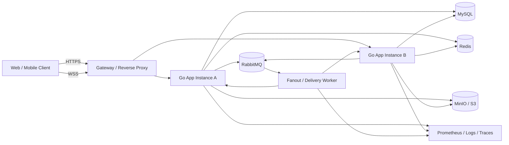
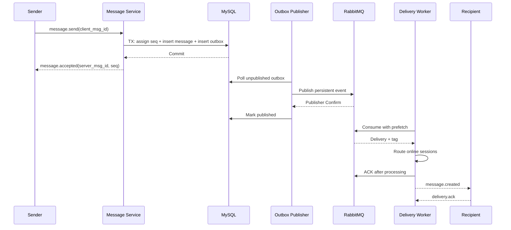

# GinChat 即时通讯系统需求与工程演进方案

| 项目 | 内容 |
| --- | --- |
| 文档版本 | v1.1 |
| 编写日期 | 2026-10-22 |
| 当前代码基线 | `master` 分支，提交 `fe81b2a`，包含工作区未提交修改 |
| 文档用途 | 梳理现有能力，定义可交付目标，指导后续开发、验收、压测和简历表达 |
| 目标定位 | 在 GinChat 原型基础上，演进为“RabbitMQ 可靠异步分发、可横向扩展、消息不丢、状态可观测”的 Go 即时通讯实战项目 |

## 1. 结论摘要

GinChat 当前已经具备一个即时通讯系统的主要骨架：Gin HTTP 服务、GORM/MySQL 持久化、JWT 与 Redis 会话校验、WebSocket 在线推送、好友申请、群组管理、Redis Stream 异步群消息消费、工作池和心跳同步。

但它仍处于“功能原型”阶段，距离可写入简历的完整项目还有四类关键缺口：

1. **安全基线不足。** 用户列表会直接返回密码哈希等字段，WebSocket 允许任意来源，令牌出现在 URL 和日志中，缺少限流、输入边界和统一鉴权规范。
2. **消息一致性不足。** 私聊消息异步写库后由 HTTP 处理器直接推送，写库失败无法感知；群消息先写库再异步进入 Redis Stream，入队失败会形成“已保存但未投递”的断点；群消息的全局状态无法表示每个成员的送达和已读情况。
3. **并发与生命周期存在缺陷。** 同一 WebSocket 连接可能被多个协程同时写；用户重连时旧连接的退出逻辑可能误删新连接；心跳协程和任务队列缺少完整的取消、排空和背压机制。
4. **工程化不足。** 缺少数据库迁移、自动化测试、统一错误码、健康检查、优雅退出、指标和链路追踪，也没有可复现的部署和压测方案。

因此，不建议直接在当前代码上继续堆接口，也不建议一开始就拆成微服务。推荐路线是：

> **先完成“模块化单体 + Outbox + RabbitMQ 可靠消息链路”，再用跨实例连接路由、故障恢复和可观测性证明扩展能力；只有在压测数据支持时才拆分服务。**

最终项目应能讲清楚四个有含金量的工程问题：

1. 如何保证“服务端已确认接收”的消息不丢？
2. 在至少一次投递下，如何避免消息重复展示？
3. 多实例部署时，用户连接不在当前进程，消息如何正确路由？
4. 如何用指标、压测和故障注入证明改动有效，而不是只描述技术名词？

## 2. 项目定位

### 2.1 产品定位

面向学习、团队协作和小规模社区的即时通讯平台。用户可以建立好友关系，进行一对一聊天，创建群聊，在多端接收实时消息，并在断线重连后恢复未读消息和会话进度。

### 2.2 工程定位

一个以 Go 工程实践为主线的实战项目，重点不是复刻微信的全部功能，而是展示以下能力：

- 以业务能力划分模块，避免 Handler、Service、Repository 成为无边界的三层模板。
- 正确处理 `context`、错误分类、事务、唯一约束和状态机。
- 使用 WebSocket 长连接承载实时信令，使用 HTTP 承载资源与会话管理。
- 使用 Outbox 解决数据库与 RabbitMQ 发布的一致性问题，再通过 Publisher Confirm、手动 ACK、TTL/DLX 重试和幂等消费实现可靠异步分发。
- 用有界并发、每连接单写协程和背压策略处理高并发连接。
- 支持多实例连接路由、水平扩容和失败恢复。
- 使用结构化日志、Prometheus 指标、分布式追踪和压测报告验证质量。

### 2.3 明确的非目标

以下内容不作为首版目标，避免项目失焦：

- 不实现音视频实时通话、端到端加密和复杂推荐系统。
- 不追求百万连接或大规模社交网络级别容量。
- 不在没有容量指标和拆分理由时引入 Kubernetes、Kafka、服务网格等重型基础设施；RabbitMQ 是本期明确采用的业务消息总线。
- 不复制第三方产品 UI，前端只实现验证核心链路的 Web 客户端。
- 不宣称“绝对不丢、Exactly Once”。项目采用可验证的“至少一次投递 + 幂等消费 + 游标补偿”。

## 3. 现有系统审计

### 3.1 已实现能力

| 能力域 | 当前实现 | 主要代码位置 | 成熟度 |
| --- | --- | --- | --- |
| 用户注册与登录 | 用户名密码注册、bcrypt 哈希、JWT 签发、Redis Token 白名单 | `internal/service/user_service.go`、`utils/security/password.go`、`utils/jwt/token.go` | 可用原型 |
| 用户资料 | 用户列表、修改资料、逻辑删除 | `internal/handler/user_handler.go`、`internal/repository/user_repository.go` | 功能有限 |
| 登出 | 更新登出状态、Token 黑名单、删除白名单 | `internal/handler/user_handler.go`、`internal/middleware/auth.go` | 基本可用 |
| 好友关系 | 好友申请、同意、拒绝、列表、删除、Redis 关系缓存 | `internal/service/friend_service.go`、`internal/repository/friend_repository.go` | 部分可靠 |
| 私聊 | REST 发送、消息落库、在线用户直接 WebSocket 推送 | `internal/handler/message_handler.go`、`internal/service/message_service.go` | 只适合演示 |
| 群聊 | 创建、加入、退出、群列表、成员列表 | `internal/service/group_service.go`、`internal/repository/group_repository.go` | 可用原型 |
| 群消息 | 先落库，再进入 Redis Stream；消费者分发给在线成员 | `internal/service/message_service.go`、`internal/consumer/group_msg_consumer.go` | 存在可靠性缺口 |
| 实时连接 | WebSocket 鉴权、连接管理、Ping/Pong、离线未送达消息推送 | `internal/ws/handler.go`、`internal/ws/manager.go` | 单机演示级 |
| 在线状态 | WebSocket 心跳写入 Redis，定时同步 MySQL | `internal/ws/handler.go`、`internal/task/heartbeat_sync.go` | 可用原型 |
| 并发控制 | 10 个 Worker、1000 容量任务队列 | `internal/workerpool/workerpool.go` | 有基本结构 |
| 基础设施 | Viper 配置、MySQL、Redis、Snowflake、Gin、GORM | `main.go`、`utils/system_init.go`、`utils/redis_util` | 缺少生产化治理 |

### 3.2 当前接口盘点

公开接口：

| 方法 | 路径 | 说明 |
| --- | --- | --- |
| `GET` | `/` | 欢迎页 |
| `POST` | `/users` | 注册用户 |
| `POST` | `/users/login` | 登录并返回 JWT |

JWT 保护接口：

| 方法 | 路径 | 说明 |
| --- | --- | --- |
| `GET` | `/users` | 用户列表 |
| `PUT` | `/users/:id` | 修改本人资料 |
| `DELETE` | `/users/:id` | 删除本人账号 |
| `POST` | `/users/logout` | 登出 |
| `POST` | `/messages` | 发送私聊消息 |
| `GET` | `/messages` | 返回在线人数，不是消息列表 |
| `POST` | `/messages/group/:id` | 发送群消息 |
| `POST` | `/friends/request` | 好友申请 |
| `GET` | `/friends/requests/received` | 收到的好友申请 |
| `GET` | `/friends/requests/sent` | 发出的好友申请 |
| `POST` | `/friends/accept/:id` | 同意申请 |
| `POST` | `/friends/reject/:id` | 拒绝申请 |
| `GET` | `/friends` | 好友列表 |
| `DELETE` | `/friends` | 删除好友 |
| `POST` | `/groups/create` | 创建群 |
| `POST` | `/groups/:id/join` | 加入群 |
| `POST` | `/groups/:id/leave` | 退出群 |
| `GET` | `/groups/my` | 我的群 |
| `GET` | `/groups/:id/members` | 群成员列表 |
| `GET` | `/ws?token=...` | WebSocket 连接 |

当前 Swagger 仅覆盖用户接口且服务端未注册 Swagger 路由，不能作为完整接口文档使用。

### 3.3 按优先级排列的主要问题

#### P0：上线前必须处理

**安全与数据暴露**

- `GET /users` 直接序列化 `UserBasic`，会返回密码哈希、登录 IP、端口和心跳时间等敏感字段。
- WebSocket Token 放在查询参数中，容易进入浏览器历史、代理日志和访问日志；中间件还会打印完整 Token。
- `CheckOrigin` 始终返回 `true`，任意站点都可建立 WebSocket 连接。
- JWT 解析未显式限制签名算法，鉴权头也未统一使用 `Bearer` 规范。
- 没有登录、注册、好友申请和消息发送限流，也没有消息长度、类型和 URL 合法性校验。
- 所有受保护资源都只校验“已登录”，没有完整校验资源级权限，例如任意登录用户可读取群成员列表。

**消息可靠性与一致性**

- 私聊 `sendText` 启动独立协程异步写库，接口却在写库前返回成功；写库失败时客户端已得到成功响应。
- 私聊通过 Handler 直接调用全局连接管理器推送，绕过 Service 和异步投递链路，存在 Handler 与基础设施耦合。
- 群消息先提交 MySQL，再异步写入 Redis Stream。如果进程在两步之间退出或入队失败，消息会落库但没有分发事件。
- 消费者把事件放入工作池后立即 ACK。任务仍在队列中时进程退出，或队列满导致任务被丢弃，都会失去重试依据。
- 群消息只有一个 `status` 字段，但群里有多个接收者；任意一个成员处理成功就可能覆盖其他成员的真实状态。
- 离线消息查询只匹配 `receiver_id = userID` 的消息，群消息的 `receiver_id` 是群 ID，因此群聊离线消息无法按用户恢复。
- 没有统一的 `client_msg_id` 幂等键，客户端超时重试可能产生重复消息。

**并发与连接生命周期**

- `ConnManager.Send` 和广播操作直接写 `websocket.Conn`。Gorilla WebSocket 不支持多个协程并发写，Ping、业务消息和广播可能冲突。
- 新连接覆盖同一用户旧连接时，旧连接的 `defer Remove(userID)` 可能删掉新连接。
- Ping ticker 在连接退出后仍可能残留协程；连接、消费者和工作池没有统一的取消机制。
- 工作池停止时立即关闭队列并取消上下文，已接收但未执行的任务可能直接丢失。

**数据完整性**

- 群成员表和好友关系表的联合唯一索引被注释，已存在业务层检查不能替代数据库约束。
- 同意好友申请时，创建双向关系与更新申请状态不是一个事务，部分失败会留下半完成状态。
- 创建群和添加群主不是一个事务，失败会产生没有群主的空群。
- 缺少正式数据库迁移，当前依赖测试代码中的 `AutoMigrate`，不利于版本管理。

#### P1：影响可用性和扩展性

- 心跳同步使用 Redis `KEYS heartbeat:*`，在 Key 数量增大时会阻塞 Redis，应改为 `SCAN`、集合或有序集合方案。
- 好友缓存没有在删除好友、同意申请等写操作后统一失效，最长可能出现一小时脏读。
- 群成员接口没有会员校验，群加入也没有邀请、审批或入群权限模型。
- 消息类型声明了图片、音频和文件，但发送逻辑只支持文本。
- 没有消息历史分页、会话列表、未读数、消息撤回、多设备同步等 IM 基础能力。
- Redis Stream 消费、数据库状态更新和 WebSocket 推送没有完整的失败分类，日志大量使用 `fmt.Printf`；当前消息总线与缓存共用 Redis，故障隔离和消费治理能力有限。
- 没有健康检查、优雅退出、指标、链路追踪、请求 ID 和统一错误码。
- 没有单元测试、集成测试、WebSocket 契约测试、竞态检测和性能测试。

### 3.4 对简历价值的判断

当前项目可以写“使用 Gin、GORM、Redis、WebSocket 实现了聊天功能”，但这类描述区分度较低，且容易被追问消息是否可靠、如何横向扩展、并发安全如何保证。

演进后的项目应把叙事从“用了哪些技术”改成“解决了什么问题、如何权衡、如何证明”：

- 从“用了 Redis Stream”升级为“用 Outbox + RabbitMQ Publisher Confirm + 手动 ACK + 幂等消费解决数据库与异步分发之间的一致性问题”。
- 从“用了 WebSocket”升级为“设计每连接单写协程、有界队列、背压和重连恢复，消除并发写与连接覆盖问题”。
- 从“实现群聊”升级为“以会话、成员游标和逐用户回执建模，支持多设备、离线恢复和未读计算”。
- 从“服务能跑”升级为“具备多实例路由、指标、压测和故障注入报告”。

## 4. 用户角色与核心场景

### 4.1 用户角色

| 角色 | 能力 |
| --- | --- |
| 游客 | 注册、登录 |
| 普通用户 | 管理个人资料；添加好友；发起私聊；创建或加入群；收发消息；管理已读状态 |
| 群主 | 普通用户能力；修改群资料；邀请或移除成员；设置管理员；解散群 |
| 群管理员 | 普通用户能力；审批入群；移除普通成员；管理群公告 |
| 系统管理员 | 处理举报、封禁账号、查看审计日志；首版可只保留接口边界 |

### 4.2 核心用户故事

1. 作为用户，我可以注册、登录并在原设备失效后安全重新认证。
2. 作为用户，我可以搜索其他用户，发送好友申请，并在对方同意后开始聊天。
3. 作为用户，我可以发送文本和图片消息，并在消息成功持久化后得到明确确认。
4. 作为用户，我可以在断线后重连，从上次同步位置恢复消息，不重复展示已处理内容。
5. 作为用户，我可以查看私聊或群聊历史，并向会话末尾方向增量加载。
6. 作为用户，我可以看到对方是否已送达、是否已读，但不会把“发到服务器”误认为“已读”。
7. 作为用户，我可以在多端登录，并让各端按设备维护自己的送达和已读进度。
8. 作为群主，我可以创建群、邀请成员、设置管理员和移除成员。
9. 作为群成员，我可以查看自己有权访问的群资料和成员，接收群消息并维护自己的已读游标。
10. 作为运维者，我可以查看在线连接、消息延迟、队列积压和错误率，并在实例故障后恢复服务。

## 5. 目标范围与优先级

### 5.1 Must：首版必须完成

| 需求编号 | 需求 | 验收重点 |
| --- | --- | --- |
| AUTH-01 | 注册、登录、刷新、登出 | 密码不落明文；统一 `Bearer`；Token 可撤销 |
| AUTH-02 | WebSocket 一次性票据 | 原生 Token 不进入 URL；票据单次有效且短时过期 |
| USER-01 | 个人资料与公开资料 | 响应 DTO 不包含密码、IP、内部状态 |
| FRIEND-01 | 好友申请与关系管理 | 双向关系、唯一约束、事务和缓存失效正确 |
| CONV-01 | 统一会话模型 | 私聊和群聊共用会话、成员、消息游标 |
| MSG-01 | 私聊和群聊消息 | 持久化成功后才返回服务端消息 ID |
| MSG-02 | 消息顺序与幂等 | 同一会话严格递增序号；客户端重试不重复落库 |
| MSG-03 | 在线实时投递 | 同一连接只有一个写协程；慢客户端不会阻塞全局 |
| MSG-04 | 离线恢复与历史分页 | 按会话游标恢复；支持 `before_seq/after_seq` |
| MSG-05 | 送达和已读 | 逐用户或逐设备维护回执，不使用群消息单一状态代替 |
| GROUP-01 | 群与成员权限 | 群主、管理员、成员权限矩阵完整 |
| REL-01 | 可靠异步分发 | Outbox + RabbitMQ；Publisher Confirm、手动 ACK、TTL/DLX 重试和消费幂等 |
| OPS-01 | 健康检查与优雅退出 | 存活、就绪、指标接口；退出时不丢已接收任务 |
| TEST-01 | 自动化质量门禁 | 单元、集成、WebSocket 端到端和竞态测试 |

### 5.2 Should：形成简历亮点

- 多实例 WebSocket 路由与 Redis 在线会话注册。
- 图片/文件对象存储，预签名直传与消息最终确认。
- 多设备同步，按设备维护同步游标。
- 未读数、会话置顶、免打扰和最近联系人。
- 消息撤回、举报和基础后台治理。
- Prometheus 指标、OpenTelemetry 链路和结构化日志。
- 基于 k6 的连接数、吞吐、延迟、长稳和故障恢复报告。

### 5.3 Could：有时间再做

- 群公告、@提醒、消息引用和表情回应。
- 关键词搜索，使用 MySQL 全文索引或独立搜索引擎。
- 消息定时发送、机器人 Webhook。
- 灰度发布和自动扩缩容。
- WebRTC 音视频或基于第三方媒体的通话能力。

### 5.4 Won't：本期不做

- 端到端加密。
- 超大规模社交推荐和复杂内容审核。
- 为展示技术而拆分微服务。
- 同时维护多套消息中间件。

## 6. 目标架构

### 6.1 总体架构



首版采用一个可执行程序承载 HTTP、WebSocket 和后台消费者，通过配置决定是否启用 Worker；需要时可将 `cmd/server` 与 `cmd/worker` 分开部署。Redis 负责缓存、限流、Presence 和设备路由快照，RabbitMQ 是唯一的业务消息总线。这样既保留单体开发效率，也不让缓存组件兼任消息队列。

### 6.2 Go 设计原则

1. **按业务能力分包。** 推荐 `identity`、`user`、`friendship`、`conversation`、`messaging`、`group`、`presence`、`media`、`platform`，而不是所有 Handler、Service、Repository 各自堆积在一个超大包中。
2. **依赖由使用方定义。** Service 需要仓储或事件发布能力时，由 Service 所在模块定义小接口；基础设施实现接口。避免为了“解耦”提前建立包含几十个方法的 God Interface。
3. **显式依赖注入。** 在 `cmd/server/main.go` 组装 App，由 App 持有 DB、Redis、RabbitMQ 生产者、连接中心、消费者和配置；逐步移除全局 `ws.Manager` 与全局 Redis Client。
4. **每个 I/O 调用携带 Context。** HTTP 请求、数据库、Redis、RabbitMQ、对象存储和消费者均支持取消与超时。后台任务使用 `signal.NotifyContext` 管理生命周期。
5. **错误必须可分类。** 区分校验错误、认证错误、权限错误、未找到、冲突、限流、基础设施错误；Handler 统一映射 HTTP 状态码和业务错误码。
6. **状态转换集中在领域服务。** 好友申请、群成员角色、消息回执等变化通过明确方法执行，不允许多个 Handler 直接拼接状态。
7. **数据库约束是最后防线。** 唯一性、状态和关联关系不能只依赖查询后再写入的业务检查。
8. **并发必须有边界。** 每个连接一个有界发送队列，全局工作池有最大并发和容量，队列满时执行背压、降级或明确失败，不能静默丢弃已确认任务。
9. **先测量再优化。** 任何缓存、分片、批处理或服务拆分都应有基准测试、火焰图、指标或压测结果支撑。

### 6.3 消息中间件决策：采用 RabbitMQ

#### 6.3.1 决策

当前 Redis Stream 能完成最小可用的群消息异步消费，但它是 Redis 的数据结构，不是专门的消息中间件。目标版本将业务事件从 Redis Stream 迁移到 RabbitMQ，Redis 不再承担消息总线职责。

这不是因为 Redis Stream 不能做队列，而是因为本项目希望展示一套更接近生产系统的消息治理能力：

- Durable Exchange/Queue 与 Persistent Message。
- Publisher Confirm 和 `mandatory` 发布结果检查。
- Consumer Prefetch、手动 ACK/NACK、Redelivery。
- Exchange + Routing Key 的显式路由。
- TTL 重试队列、Dead Letter Exchange 和 DLQ。
- RabbitMQ Management 与 Prometheus 插件提供的队列治理能力。
- 生产者、消费者和消息中间件的独立部署与故障隔离。

RabbitMQ 仍然不能保证“数据库和消息队列同时成功”，所以 **Outbox 不可删除**。正确关系是：MySQL 事务负责消息与 Outbox 原子提交，RabbitMQ 负责 Outbox 事件之后的可靠异步分发。

#### 6.3.2 Redis Stream 与 RabbitMQ 对比

| 维度 | Redis Stream | RabbitMQ | 本项目选择 |
| --- | --- | --- | --- |
| 组件定位 | Redis 中的日志型数据结构 | 专用消息代理 | RabbitMQ |
| 典型优势 | 部署简单、吞吐高、已有 Redis 时成本低 | 路由、确认、重试、DLQ、管理界面完整 | RabbitMQ |
| 发布确认 | 依赖命令结果与应用侧补偿 | Publisher Confirm、Return | RabbitMQ |
| 消费确认 | Consumer Group、Pending、XACK | Delivery Tag、Ack/Nack、Redelivery | RabbitMQ |
| 灵活路由 | 主要按 Stream 和 Consumer Group | Topic/Direct/Fanout Exchange | RabbitMQ |
| 延迟重试 | 通常自行实现 | TTL + DLX 或延迟插件 | RabbitMQ |
| 死信治理 | 自行实现 | DLX + DLQ 原生组合 | RabbitMQ |
| 可观测性 | 需额外建设 | Management、Prometheus、队列深度 | RabbitMQ |
| 运维成本 | 复用 Redis，较低 | 多一个基础组件，较高 | 接受额外成本换取治理能力 |
| 顺序保证 | 单 Stream 内顺序较直观 | 多消费者和重入队时不能依赖全局顺序 | 两者都用业务 `seq` 排序 |
| 适用阶段 | 原型、轻量事件流 | 中小规模业务消息与可靠任务 | 实战项目目标态 |

结论：如果项目只停留在课程作业，Redis Stream 足够；如果目标是展示可靠消息设计和消息治理，RabbitMQ 更合适。Kafka 更适合高吞吐事件流和长期回放，本项目当前吞吐规模和路由需求不足以证明引入 Kafka 的必要性。

#### 6.3.3 RabbitMQ 拓扑

建议拓扑如下，生产环境优先使用 Quorum Queue，本地可用 Classic Queue 降低资源占用：

| 名称 | 类型 | 用途 |
| --- | --- | --- |
| `im.events` | Durable Topic Exchange | 业务领域事件 |
| `im.delivery` | Direct Exchange | 投递到指定应用实例 |
| `im.dlx` | Durable Direct Exchange | 失败消息进入重试或死信 |
| `im.message.fanout.v1` | Durable Quorum Queue | 消费 `message.created.v1` 并执行群扇出 |
| `im.message.retry.5s.v1` | TTL Queue | 5 秒后经 DLX 重回业务 Exchange |
| `im.message.retry.30s.v1` | TTL Queue | 30 秒后重试 |
| `im.message.retry.2m.v1` | TTL Queue | 2 分钟后重试 |
| `im.message.dlq.v1` | Dead Letter Queue | 达到最大重试次数后人工排查 |
| `im.delivery.node.<instance_id>` | Exclusive Auto-delete Queue | 当前实例的 WebSocket 投递队列 |

路由键建议：

```text
message.created.v1
conversation.member_changed.v1
message.recall.v1
delivery.node.<instance_id>
```

事件信封：

```json
{
  "event_id": "evt_01J...",
  "event_type": "message.created.v1",
  "occurred_at": "2026-10-22T12:00:00Z",
  "trace_id": "trace-id",
  "aggregate_id": "conversation-id",
  "payload": {
    "message_id": "message-id",
    "conversation_id": "conversation-id",
    "seq": 1001
  }
}
```

消费策略：

1. `im.message.fanout.v1` 消费消息创建事件，解析会话成员和在线设备，再向目标实例发布投递命令。
2. 目标实例从自己的 `im.delivery.node.<instance_id>` 队列消费，将事件放入对应连接的本地有界发送队列。
3. 只有业务处理成功或投递命令成功进入本地发送队列后才 ACK。
4. 可重试错误通过 TTL 队列指数退避，达到上限后进入 DLQ。
5. 解析失败、版本不支持、数据不合法等不可重试错误直接进入 DLQ，避免无限重入。
6. 消费端按 `event_id` 或 `message_id` 幂等；重复投递不能产生重复业务状态。
7. 不依赖 RabbitMQ 的全局消费顺序。消息显示顺序由 MySQL 中同一会话的 `seq` 决定，客户端可缓冲短暂缺口并使用 HTTP 补拉。

#### 6.3.4 Go 实现约束

依赖使用 `github.com/rabbitmq/amqp091-go`。只在消息模块需要发布和消费事件的位置定义小接口：

```go
type EventPublisher interface {
	Publish(ctx context.Context, event EventEnvelope) error
}

type EventHandler func(ctx context.Context, event EventEnvelope) error
```

实现要求：

- `amqp.Connection` 与 `amqp.Channel` 都不应被多个 Goroutine 无约束并发复用；每个生产或消费协程明确拥有自己的 Channel。
- 生产端启用 Confirm，持久化消息，检查 ACK/NACK 和 `mandatory` 返回；发布超时不能直接认定消息未发送，重发必须依赖下游幂等。
- 消费端设置合理 Prefetch，手动 ACK；业务执行超过 Context 截止时间时记录可重试错误并释放投递。
- 连接关闭、Channel 取消、Broker 重启后自动重建拓扑并恢复消费。
- 消费者使用有界工作流水线，停止时先停止拉取、排空已确认可处理的任务，再关闭 Channel。
- 所有阻塞调用接收 `context.Context`，错误使用 `%w` 包装并保留业务码；禁止为“让代码简洁”忽略错误。
- 配置通过环境变量或配置文件注入，至少包含连接地址、VHost、Prefetch、重试次数、发布超时和拓扑前缀。
- 生产连接与消费连接分开，避免发布压力影响消费心跳；对应用与 Broker 均增加心跳和连接恢复指标。

#### 6.3.5 从 Redis Stream 迁移

1. 先抽出 `EventPublisher` 和 `EventHandler`，业务层只依赖接口，不直接依赖 Redis 或 RabbitMQ。
2. 增加 Outbox 表和发布器，停止在 HTTP Handler 中直接触发异步分发。
3. 实现 RabbitMQ Adapter、拓扑声明、重连和 Consumer，并在独立测试环境验证。
4. 灰度或维护窗口内停止 Redis Stream 消费，处理 Pending 消息并停止生产。
5. 切换配置为 RabbitMQ 单一消息总线，核对消息数量、失败数和 DLQ。
6. 删除 Redis Stream 业务代码和 `redis_util` 中的 Stream 职责，Redis 继续保留缓存、限流、Presence 和连接路由快照。

迁移期间不能同时让两套总线对同一事件执行有副作用的消费，除非消费端具备强幂等并明确验证重复处理安全。对这个原型项目，更推荐短暂停写后一次性切换。

### 6.4 建议目录

```text
ginChatProject/
├── cmd/
│   ├── server/main.go
│   └── worker/main.go
├── internal/
│   ├── app/
│   ├── platform/
│   │   ├── config/
│   │   ├── mysql/
│   │   ├── redis/
│   │   ├── rabbitmq/
│   │   ├── observability/
│   │   └── transport/
│   ├── identity/
│   │   ├── service/
│   │   ├── repository/
│   │   └── transport/http/
│   ├── user/
│   ├── friendship/
│   ├── conversation/
│   ├── messaging/
│   │   ├── domain/
│   │   ├── service/
│   │   ├── repository/
│   │   ├── outbox/
│   │   └── transport/ws/
│   ├── groupchat/
│   ├── presence/
│   └── media/
├── migrations/
├── api/
│   ├── openapi.yaml
│   └── websocket.md
├── deploy/
│   ├── docker-compose.yml
│   └── prometheus/
├── test/
│   ├── integration/
│   ├── e2e/
│   └── load/
└── docs/
```

不要求一次性完成目录迁移。可以在保持现有包可运行的前提下，按“会话与消息”优先级逐步抽取，每个里程碑都保持测试通过。

## 7. 领域模型与数据设计

### 7.1 核心模型

现有模型把私聊、群聊、消息与回执混在少量表中，建议增加统一会话模型。

| 表 | 关键字段 | 说明 |
| --- | --- | --- |
| `users` | `id`、`username`、`password_hash`、`status`、`created_at` | 密码只保存哈希；禁止直接 JSON 序列化 |
| `user_profiles` | `user_id`、`nickname`、`avatar_url`、`bio` | 与认证数据分离 |
| `devices` | `id`、`user_id`、`platform`、`last_seen_at`、`revoked_at` | 多设备会话和送达 |
| `friendships` | `user_low_id`、`user_high_id`、`status` | 一条对称关系；`UNIQUE(user_low_id, user_high_id)` |
| `friend_remarks` | `friendship_id`、`user_id`、`remark` | 双方各自独立备注；`PRIMARY KEY(friendship_id, user_id)` |
| `friend_requests` | `id`、`from_user_id`、`to_user_id`、`status`、`version` | 防止重复和并发处理 |
| `conversations` | `id`、`type`、`owner_id`、`last_seq`、`last_message_id` | 私聊、群聊统一入口 |
| `conversation_members` | `conversation_id`、`user_id`、`role`、`last_read_seq`、`joined_at`、`left_at` | `PRIMARY KEY(conversation_id, user_id)` |
| `messages` | `id`、`conversation_id`、`seq`、`client_msg_id`、`sender_id`、`type`、`content`、`created_at` | `UNIQUE(conversation_id, seq)`；`UNIQUE(sender_id, client_msg_id)` |
| `message_deliveries` | `message_id`、`device_id`、`delivered_at` | 按设备维护送达；已读使用成员表 `last_read_seq` |
| `outbox_events` | `id`、`aggregate_id`、`event_type`、`payload`、`status`、`retry_count`、`next_retry_at` | 可靠异步分发 |
| `attachments` | `id`、`owner_id`、`object_key`、`mime_type`、`size`、`checksum`、`status` | 媒体元数据 |
| `audit_logs` | `actor_id`、`action`、`resource_type`、`resource_id`、`result` | 敏感操作审计 |

### 7.2 会话与消息序号

每条消息必须属于一个 `conversation_id`。`seq` 是该会话内严格递增的序号，用于：

- 客户端排序，不依赖客户端时钟。
- 断线重连后按游标拉取，避免长期依赖离线消息状态。
- 计算未读数：`last_seq - last_read_seq`。
- 发现消息缺口并触发补拉。

实现建议：在事务内锁定 `conversations` 对应行并递增 `last_seq`，然后插入消息。Snowflake 继续作为全局消息 ID，不承担会话内排序职责。

### 7.3 消息状态语义

消息状态需要分清层次：

| 状态 | 含义 | 保存位置 |
| --- | --- | --- |
| Accepted | 服务端已持久化并分配 `message_id`、`seq` | `messages` |
| Delivered | 目标设备已收到并确认 | `message_deliveries.delivered_at` |
| Read | 用户已把会话已读游标推进到该消息 | `conversation_members.last_read_seq` 或回执表 |

“已发送”“已送达”“已读”不能共用一个字段表达，尤其不能在群聊中共享同一状态。

### 7.4 可靠投递链路

推荐写路径：



关键规则：

1. 业务数据与 Outbox 事件在同一事务中提交。
2. Outbox Publisher 采用多实例安全领取、指数退避和死信策略；RabbitMQ 必须开启 Publisher Confirm，持久化 Exchange、Queue 和 Message。
3. RabbitMQ 提供至少一次消费，Broker Confirm 或客户端超时重发仍可能产生重复，不承诺 Exactly Once。
4. 消费端以 `message_id` 或 `event_id` 做幂等；可重试失败进入 TTL 重试队列，不可重试或超限失败进入 DLQ。
5. 客户端以 `server_msg_id` 去重，以 `seq` 排序和补洞。
6. 只有在分发处理完成后才手动 ACK；慢消费者通过 Prefetch 和本地有界队列限制影响范围，并暴露 Unacked、Ready 和 Redelivery 指标。
7. 离线用户不需要队列中长期堆积每个用户的副本，可通过会话游标补拉历史。
8. 不依赖 RabbitMQ 队列顺序实现消息业务顺序；同一会话可能因多消费者、重试或跨实例投递乱序，最终以 `seq` 排序。

### 7.5 多实例连接路由

单机 `map[userID]conn` 不能支持多实例。目标方案：

1. WebSocket 握手成功后，将 `device_id -> instance_id` 和 `user_id -> device_id 集合` 写入 Redis，并设置短 TTL。
2. 每实例声明独占、自动删除的 RabbitMQ 队列 `im.delivery.node.<instance_id>`，绑定到 `im.delivery` Direct Exchange。
3. 投递 Worker 查询路由，将投递命令发布到目标实例队列的 Routing Key。
4. 目标实例只向本地连接写数据。
5. 实例异常后，路由 TTL 自动过期；客户端通过带抖动的指数退避重连。
6. 所有业务消息仍以 MySQL 会话游标为最终事实来源，路由只负责实时加速，不能成为唯一存储。
7. 目标实例队列不可达时，消息不能视为最终送达；客户端重连后通过会话游标补拉。

## 8. 功能需求

### 8.1 身份认证与用户

| 编号 | 需求 | 详细规则 |
| --- | --- | --- |
| AUTH-01 | 注册 | 用户名唯一；密码长度与复杂度校验；bcrypt/Argon2id 哈希；返回公开用户信息 |
| AUTH-02 | 登录 | 支持设备标识；失败信息不泄露账号是否存在；登录限流 |
| AUTH-03 | Token | 短期 Access Token；Refresh Token 轮换和撤销；统一 `Authorization: Bearer` |
| AUTH-04 | 登出 | 撤销 Token、关闭设备连接；不依赖前端主动断开 |
| AUTH-05 | WS Ticket | 已认证用户申请 30 秒内单次使用的 WS 票据；URL 中不出现长期 Token |
| USER-01 | 我的资料 | 修改昵称、头像、简介；所有响应使用 DTO |
| USER-02 | 用户查询 | 支持按用户名/ID 精确查询，不允许敏感字段外泄 |
| USER-03 | 账号注销 | 逻辑删除或冷却期；撤销全部会话；处理好友和群成员关系 |

### 8.2 好友关系

- 支持发送、撤回、同意和拒绝好友申请。
- 同一对用户最多存在一条待处理申请，数据库和业务层双重保证。
- 同意申请必须在事务中完成“创建双向好友关系 + 更新申请状态”。
- 删除好友后立即使相关 Redis 缓存失效。
- 拉黑后禁止对方发送私聊和好友申请。
- 好友申请和关系查询使用分页，禁止一次返回无界列表。

### 8.3 会话与消息

- 首次私聊时自动创建私聊会话；同一对用户只允许一个有效私聊会话。
- 群创建时创建群会话，并保证群主同时成为成员。
- 客户端发送消息必须携带 `client_msg_id`，服务端据此保证幂等。
- 文本、图片、文件等消息使用明确的内容结构，禁止在同一字段中混用任意 JSON。
- 服务端接受消息后返回 `message_id` 和 `seq`；此时才能向 UI 显示“已发送”。
- 支持按 `before_seq` 和 `after_seq` 拉取历史，默认 20 条，最大 100 条。
- 支持按会话维护 `last_read_seq`，未读数由游标计算。
- 支持多设备同步；同一用户的多个设备可以接收消息，但回执按设备记录。
- 消息重试、重连和消费重放不得产生重复展示。
- 首版支持文本与图片；文件、音频可以在 Should 阶段加入。

### 8.4 群组

| 操作 | 群主 | 管理员 | 成员 | 非成员 |
| --- | --- | --- | --- | --- |
| 查看群资料 | 是 | 是 | 是 | 仅公开摘要 |
| 查看成员列表 | 是 | 是 | 是 | 否 |
| 修改群资料 | 是 | 可配置 | 否 | 否 |
| 邀请/审批成员 | 是 | 是 | 可配置 | 否 |
| 移除成员 | 是 | 仅普通成员 | 否 | 否 |
| 设置管理员 | 是 | 否 | 否 | 否 |
| 解散群 | 是 | 否 | 否 | 否 |
| 退群 | 否，需先转让或解散 | 是 | 是 | 否 |

群成员表必须建立联合唯一约束。创建群、加入群、退群和角色变更必须有事务或明确的状态转换。

### 8.5 媒体消息

- 客户端先向后端申请上传凭证，再直接上传到 MinIO/S3。
- 上传完成后调用 `finalize` 接口登记 `object_key`、大小、MIME 类型和校验值。
- 服务端只接受已登记且属于当前用户的对象。
- 限制文件大小、扩展名、MIME 和访问策略；私有对象使用短时签名 URL。
- 图片消息发送与普通消息一样经过幂等、序号和 Outbox 链路。

### 8.6 在线状态

- 状态分为在线、离开、离线；首版只要求在线/离线。
- 连接握手后建立带 TTL 的 Presence 记录。
- Ping/Pong 更新连接活跃时间，不由客户端业务 JSON 冒充心跳。
- 关闭连接、登出或实例失联后及时清理。
- 禁止使用 Redis `KEYS` 扫描全量心跳；使用 Sorted Set、SCAN 或按实例维护集合。
- 在线状态只是优化信息，不作为消息是否可恢复的依据。

## 9. 接口约定

### 9.1 HTTP API

建议统一使用 `/api/v1` 前缀、JSON 命名和下表中的资源化路径：

| 模块 | 方法与路径 | 说明 |
| --- | --- | --- |
| 认证 | `POST /api/v1/auth/register` | 注册 |
| 认证 | `POST /api/v1/auth/login` | 登录 |
| 认证 | `POST /api/v1/auth/refresh` | 刷新令牌 |
| 认证 | `POST /api/v1/auth/logout` | 登出 |
| 认证 | `POST /api/v1/auth/ws-ticket` | 获取一次性 WS 票据 |
| 用户 | `GET /api/v1/users/:id` | 公开资料 |
| 用户 | `GET /api/v1/me` | 我的资料 |
| 用户 | `PATCH /api/v1/me` | 修改资料 |
| 好友 | `POST /api/v1/friend-requests` | 创建申请 |
| 好友 | `POST /api/v1/friend-requests/:id/accept` | 同意 |
| 好友 | `POST /api/v1/friend-requests/:id/reject` | 拒绝 |
| 好友 | `GET /api/v1/friends` | 好友列表 |
| 会话 | `GET /api/v1/conversations` | 会话列表 |
| 会话 | `POST /api/v1/conversations/private` | 创建或获取私聊会话 |
| 会话 | `GET /api/v1/conversations/:id/messages` | 历史消息 |
| 会话 | `POST /api/v1/conversations/:id/messages` | HTTP 兜底发送 |
| 会话 | `POST /api/v1/conversations/:id/read` | 推进已读游标 |
| 群组 | `POST /api/v1/groups` | 创建群 |
| 群组 | `GET /api/v1/groups/:id` | 群资料 |
| 群组 | `POST /api/v1/groups/:id/invitations` | 邀请成员 |
| 群组 | `DELETE /api/v1/groups/:id/members/:userID` | 移除成员 |
| 群组 | `PATCH /api/v1/groups/:id/members/:userID/role` | 修改角色 |
| 媒体 | `POST /api/v1/uploads/presign` | 获取上传凭证 |
| 媒体 | `POST /api/v1/uploads/:id/finalize` | 确认上传 |
| 运维 | `GET /health/live` | 进程存活 |
| 运维 | `GET /health/ready` | 依赖就绪 |
| 运维 | `GET /metrics` | Prometheus 指标 |

统一响应结构建议：

```json
{
  "code": "MESSAGE_ACCEPTED",
  "message": "message accepted",
  "request_id": "req_01J...",
  "data": {}
}
```

错误至少包含稳定的业务码、HTTP 状态码和 `request_id`。生产环境不直接返回数据库错误或堆栈。

### 9.2 WebSocket 协议

连接地址：

```text
wss://chat.example.com/ws?ticket=<one-time-ticket>
```

统一信封：

```json
{
  "version": 1,
  "type": "message.send",
  "request_id": "client-generated-id",
  "timestamp": 1760000000000,
  "data": {}
}
```

客户端事件：

| `type` | 说明 |
| --- | --- |
| `message.send` | 发送消息；包含 `client_msg_id`、`conversation_id`、`message_type` 和内容 |
| `delivery.ack` | 确认某设备已收到指定消息 |
| `read.update` | 将会话已读游标推进到指定 `seq` |
| `presence.ping` | 仅作为业务兼容；连接保活优先使用 WebSocket Ping/Pong |

服务端事件：

| `type` | 说明 |
| --- | --- |
| `session.ready` | 握手完成，返回设备 ID 和服务器时间 |
| `message.accepted` | 消息已持久化，返回 `message_id`、`seq` |
| `message.created` | 向接收方推送新消息 |
| `message.read` | 已读游标更新 |
| `message.delivery` | 送达回执更新 |
| `sync.required` | 发现游标缺口或客户端版本过期，要求走 HTTP 补拉 |
| `error` | 稳定错误码、是否可重试和 `request_id` |

必须保证：

- 每个连接只有一个写协程。
- 发送队列有界；队列满时先施加背压，超时后返回可重试错误。
- 客户端按 `server_msg_id` 去重，按 `seq` 排序。
- 连接关闭后停止 Ping、路由记录和发送协程。
- 重连使用指数退避和随机抖动，避免故障恢复时连接风暴。

## 10. 非功能需求

以下指标是项目目标，不是当前已达成结果。最终简历中的数字必须来自实际压测报告。

| 类别 | 目标 |
| --- | --- |
| 正确性 | 服务端已确认的消息不因单实例崩溃丢失；重试不产生重复业务消息 |
| 实时性 | 基线环境内，消息 Accepted 的 P95 不高于 150 ms；端到端在线投递 P95 不高于 500 ms |
| 稳定性 | 200 条/秒持续 30 分钟，错误率低于 0.1%，无内存持续增长 |
| 连接能力 | 单实例支持至少 5,000 个空闲 WebSocket 连接，具体以上线压测结果为准 |
| 可恢复性 | 实例重启后客户端可自动重连并按游标补拉；无人工修复数据 |
| 可观测性 | 所有请求具备 `request_id`；关键链路具备结构化日志、指标和 Trace |
| 安全性 | Token 不进 URL 日志；敏感字段不出 API；主要写接口有限流和大小限制 |
| 可维护性 | `go test ./...`、`go test -race ./...`、`go vet ./...` 和静态检查通过 |
| 部署性 | 一条命令启动本地环境；配置和密钥不提交仓库；镜像可重复构建 |

### 10.1 性能测试口径

至少建立以下场景：

1. **连接建立。** 逐步建立 5,000 个 WebSocket 连接，记录成功数、握手 P50/P95/P99、内存和文件描述符。
2. **小群广播。** 50 人群、每群 20 人在线，持续发送消息，观察扇出延迟和设备发送队列。
3. **私聊吞吐。** 500 对在线用户持续收发，记录 Accepted 延迟和端到端延迟。
4. **离线恢复。** 用户离线产生 10,000 条消息，重连后从游标分批恢复，验证顺序、完整性和内存。
5. **消费者故障。** 杀掉 Worker 后再启动，验证 Pending 消息恢复和幂等。
6. **实例故障。** 两实例部署，关闭其中一个，验证客户端重连、路由清理和其他实例正常服务。
7. **长稳测试。** 30 至 60 分钟持续负载，观察 Goroutine、连接、队列、GC、P99 和错误率。

## 11. 安全需求

- 使用配置中心或环境变量管理 JWT Secret、数据库密码、Redis 密码和对象存储密钥，仓库只保留 `.env.example`。
- `JWT` 校验指定允许的签名算法，检查 `iss`、`aud`、`exp`、`jti`；Access Token 建议 15 至 30 分钟。
- Refresh Token 轮换并保存哈希，检测重复使用。
- WebSocket 使用一次性短时票据；严格限制 Origin 和允许域名。
- HTTP 设置请求体上限、Header 上限和读超时；WebSocket 限制帧大小。
- 登录、注册、好友申请、消息发送、上传凭证接口限流。
- 所有资源查询执行对象级授权，不能只判断“已登录”。
- 日志脱敏 Token、密码、Cookie、手机号、邮箱和文件签名 URL。
- 图片和文件执行大小、MIME、扩展名和恶意内容校验；对象默认私有。
- 对账号封禁、成员移除、Token 撤销等安全操作写审计日志。
- 依赖锁定版本并纳入漏洞扫描。

## 12. 可观测性与运维

### 12.1 结构化日志

建议使用标准库 `log/slog` 输出 JSON，至少包含：

- `request_id`、`trace_id`、`span_id`
- `user_id`、`device_id`、`conversation_id`
- `message_id`、`client_msg_id`
- `event_type`、`duration_ms`、`error_code`

禁止记录完整 Token、密码、消息敏感全文和签名 URL。

### 12.2 关键指标

| 指标 | 用途 |
| --- | --- |
| `im_ws_connections_active` | 当前连接数 |
| `im_ws_connect_total{result}` | 握手成功率 |
| `im_ws_write_queue_depth` | 单连接发送队列深度 |
| `im_message_accepted_total` | 已持久化消息数 |
| `im_message_accept_duration_seconds` | 消息接受延迟 |
| `im_message_e2e_duration_seconds` | 端到端投递延迟 |
| `im_outbox_unpublished_total` | Outbox 积压 |
| `im_mq_publish_total{result}` | RabbitMQ 发布结果 |
| `im_mq_publish_confirm_seconds` | Publisher Confirm 延迟 |
| `im_mq_consumer_unacked` | 当前未确认投递数 |
| `im_mq_ready_messages` | 队列可消费积压 |
| `im_mq_redelivery_total` | 重投递次数 |
| `im_mq_dlq_total{queue}` | 死信数量 |
| `im_delivery_retry_total{reason}` | 投递重试 |
| `im_ws_auth_failure_total` | 鉴权失败和攻击信号 |
| `go_goroutines`、GC、堆内存 | 连接泄漏和内存稳定性 |

### 12.3 健康检查与生命周期

- `/health/live` 只判断进程是否可响应。
- `/health/ready` 检查必要依赖和初始化状态，避免把可选依赖故障当成全站故障。
- 接收 `SIGTERM` 后停止接收新连接，等待活动请求和发送队列排空，再关闭消费者和数据库。
- 设置 HTTP、WebSocket、数据库、Redis、RabbitMQ 和对象存储超时。
- 暴露受保护的 pprof，生产环境默认关闭或限制内网访问。

## 13. 测试策略

### 13.1 测试分层

| 层级 | 范围 | 工具建议 |
| --- | --- | --- |
| 单元测试 | 领域状态机、消息序号、权限、幂等、回执计算 | Go `testing`、表驱动测试 |
| Repository 集成测试 | MySQL 唯一约束、事务、分页、并发自增 | Testcontainers 或测试数据库 |
| RabbitMQ 集成测试 | Confirm、Ack/Nack、重投递、TTL 重试、DLX/DLQ 和重复消费 | Testcontainers RabbitMQ |
| Redis 集成测试 | 缓存失效、限流、Presence 和设备路由 TTL | 测试 Redis 实例 |
| HTTP 契约测试 | 请求校验、错误码、鉴权、分页 | `httptest` |
| WebSocket E2E | 鉴权、发送、接收、ACK、已读、重连、补拉 | Go WebSocket 客户端 |
| 竞态测试 | 连接覆盖、关闭、工作池、缓存失效 | `go test -race` |
| 压测 | 连接数、吞吐、延迟、长稳 | k6 WebSocket/K6 HTTP |
| 故障注入 | RabbitMQ/Redis/MySQL 短暂不可用、进程退出、队列满和连接抖动 | Docker Compose 脚本 |

### 13.2 必测场景

1. 同一 `client_msg_id` 重复提交 100 次，只产生一条消息。
2. 两个用户并发创建同一私聊会话，只产生一个会话。
3. 100 人群同一时刻发消息，`seq` 无重复且可连续补洞。
4. 客户端收到重复投递时可按 `message_id` 去重。
5. 群消息被部分成员接收后 Consumer 崩溃，重启后其余用户可补收。
6. 同一用户重连，旧连接退出不会删除新连接。
7. 慢客户端不阻塞其他用户，超时后可降级并在重连后补拉。
8. 删除好友后缓存立即失效，双方私聊权限符合规则。
9. 无权限用户读取群成员、发送群消息时返回 403。
10. 退出登录后 HTTP 与 WebSocket 均不可继续使用已撤销凭证。
11. RabbitMQ 发布后故意不返回 Confirm，重启发布器后只产生可被幂等消费的重复事件。
12. Consumer 处理失败时按 TTL 队列重试，达到上限后进入 DLQ；不可重试消息不会无限重入。
13. 两个 Consumer 并发消费同一会话消息，客户端仍可按 `seq` 恢复为正确顺序。

### 13.3 CI 质量门禁

每次提交至少执行：

```text
go fmt ./...
go vet ./...
go test ./...
go test -race ./...
go test -cover ./...
staticcheck ./...
golangci-lint run ./...
go build ./cmd/server ./cmd/worker
```

同时生成 OpenAPI 校验、依赖漏洞扫描、Docker 构建和关键 E2E 测试结果。简历中可以展示 CI 流水线截图和最近的测试报告，但不要伪造覆盖率。

## 14. 实施路线

以下是建议顺序，时间按个人或小团队节奏估算，重点在于依赖关系而非固定工期。

### 阶段 0：基线与安全止血，2 至 3 天

- 建立配置模板、数据库迁移和本地 Docker Compose。
- 移除 API 敏感字段，用户列表改为 DTO，增加分页。
- 统一 Token 读取、JWT 算法校验和错误响应。
- 删除 Token 日志，限制 WebSocket Origin，改用一次性 WS 票据。
- 增加消息、好友申请和登录的基本校验与限流。
- 建立 CI 骨架和当前行为基线测试。

退出标准：现有接口不暴露敏感字段；无 Token 日志；自动化构建通过。

### 阶段 1：并发与生命周期修复，4 至 6 天

- 重写连接管理器，每连接一个写协程、一个有界发送队列。
- 用户重连时按设备管理连接，旧连接退出只能删除自己的会话。
- 使用 Context 管理 Ping、读循环、写协程和消费者。
- 实现优雅退出和任务排空。
- 修复 Node 关闭、Worker 停止、连接覆盖和 Goroutine 泄漏。

退出标准：`go test -race` 通过；连续连接/断开 10,000 次后 Goroutine 和内存保持稳定。

### 阶段 2：会话与消息域重构，7 至 10 天

- 引入 `conversations`、`conversation_members`、消息序号和客户端幂等键。
- 实现私聊、群聊统一消息路径。
- 实现历史分页、已读游标和未读计算。
- 使用逐用户/设备回执替代群消息单一状态。
- 修复离线恢复和群消息不可拉取问题。

退出标准：私聊、群聊、历史、离线恢复和已读 E2E 全部通过；重复提交不重复落库。

### 阶段 3：RabbitMQ 可靠异步链路，5 至 7 天

- 引入 Outbox 表和发布器。
- 消息与 Outbox 同事务提交。
- 定义 `EventPublisher` 与 `EventHandler`，隔离业务层和 Broker。
- 接入 RabbitMQ，声明 Exchange、Quorum Queue、TTL 重试队列、DLX 和 DLQ。
- 开启 Publisher Confirm 与 Persistent Message，消费端使用 Prefetch 和手动 ACK/NACK。
- 实现连接重建、拓扑恢复、幂等消费、指数退避和积压指标。
- 停写并迁移现有 Redis Stream 事件，随后移除 Stream 业务代码。
- 移除 Handler 直接推送和“异步入库后立即返回”的不可靠路径。

退出标准：在进程任意位置终止后重启，已确认消息可恢复投递；队列满不会静默丢失任务。

### 阶段 4：多实例与 Presence，4 至 6 天

- Redis 保存设备和实例路由。
- 通过实例专属 RabbitMQ 队列跨节点投递。
- 优化心跳清理，移除 `KEYS`。
- 两实例部署验证用户跨实例聊天、实例故障和重连。

退出标准：任一实例停止后，另一实例仍可服务；客户端无需人工干预即可恢复。

### 阶段 5：可观测性与性能，3 至 5 天

- 增加结构化日志、请求 ID、Prometheus 指标和追踪。
- 增加 pprof 开关和 Grafana 看板。
- 编写 k6 场景，完成连接、吞吐、长稳和故障恢复报告。
- 根据火焰图和指标做一次有证据的优化。

退出标准：可出示压测报告和看板截图；性能改善有前后对比数据。

### 阶段 6：前端与演示交付，3 至 5 天

- Web 客户端完成注册、登录、好友、私聊、群聊、历史、未读和在线状态。
- 提供一键演示脚本和种子数据。
- 编写部署文档、架构决策记录、故障演练脚本和演示视频。

退出标准：陌生人按 README 可以在 10 分钟内启动并完成核心流程。

## 15. 验收标准

### 15.1 核心业务验收

- 两个用户可完成注册、登录、好友申请、同意和私聊。
- 私聊双方在任何在线/离线组合下都能最终获得消息。
- 群主可创建群、邀请成员，管理员权限符合矩阵。
- 群成员按权限查看群资料和成员列表。
- 所有会话具备稳定顺序、分页历史和未读游标。
- 断线重连后不丢失消息、不重复展示、不需要用户手动清理缓存。
- 送达和已读状态在多成员群、多设备场景下语义正确。

### 15.2 可靠性与并发验收

- 同一 `client_msg_id` 重试只产生一条业务消息。
- 单实例被强制终止后，已 Accepted 的消息能够恢复投递。
- Consumer 崩溃后 Unacked 事件可重投递，TTL 重试和 DLQ 行为符合配置，重复消费不会破坏状态。
- 1,000 次并发连接覆盖测试无错误删除新连接。
- 慢客户端不会导致其他连接发送超时或全局阻塞。
- 在队列达到上限时，系统返回明确可重试错误或实施背压，不静默丢弃。

### 15.3 安全与运维验收

- API 响应中不存在密码哈希、Token、内部 IP 等敏感字段。
- WS 握手不接受任意 Origin 和长期原始 Token。
- 撤销 Token 后 HTTP 和 WS 均无法继续访问受保护资源。
- 日志中无法搜索到完整 Token、密码和签名 URL。
- `/health/live`、`/health/ready` 和 `/metrics` 行为符合预期。
- 服务能够优雅退出并完成资源释放。

### 15.4 交付物验收

- README 包含架构图、快速启动、配置说明、接口示例和常见问题。
- `api/openapi.yaml` 与实际 HTTP 接口一致。
- WebSocket 事件有独立协议文档和示例。
- 数据库迁移可从空库完整执行。
- CI 通过，压测报告包含测试环境、脚本、指标和结论。
- 至少有两份架构决策记录，分别解释模块化单体边界，以及为什么选择 Outbox + RabbitMQ 而不是直接用 Redis Stream。

## 16. 演示与作品集表达

### 16.1 推荐演示脚本

1. 两个浏览器账号互加好友并发送私聊，展示已发送、已送达、已读状态。
2. 创建群、邀请成员，展示群消息和每个成员的已读进度。
3. 关闭其中一个客户端，发送多条消息，再重连展示游标恢复和无重复。
4. 在消息处理过程中重启 Consumer，展示 Unacked 重投递、TTL 重试、DLQ 和 Outbox 指标变化。
5. 启动两个服务实例，让两个用户分别连接不同实例，展示跨实例投递。
6. 打开 Grafana，展示连接数、消息延迟、队列积压和错误率。
7. 展示 k6 压测结果和一次基于 pprof 的优化前后对比。

### 16.2 简历项目描述模板

以下内容需要在实现并实测后使用，方括号中的数据不得提前编造：

> **Go 即时通讯平台（个人项目）**
>
> 基于 Go、Gin、MySQL、Redis、RabbitMQ、WebSocket 构建支持私聊、群聊、多设备同步和离线恢复的即时通讯系统。采用模块化单体划分身份、好友、会话、消息、群组和 Presence 模块，以 MySQL 作为消息最终事实来源，RabbitMQ 承担异步事件分发。
>
> - 设计“会话 + 会话内单调序号 + 客户端幂等键”，通过 Outbox 与服务端消息同事务提交；使用 RabbitMQ Publisher Confirm、手动 ACK、TTL/DLX 重试和幂等消费，实现至少一次异步投递并避免重复业务状态。
> - 重构 WebSocket 连接层为每连接单写协程与有界队列，修复并发写、连接覆盖和 Goroutine 泄漏；使用 Redis 保存实例路由、RabbitMQ Direct Exchange 路由实例投递命令，支持多实例跨节点通信。
> - 以 `last_read_seq` 和逐设备回执建模未读与送达，支持断线重连、游标补拉和消息缺口恢复。
> - 建立 Prometheus、结构化日志、链路追踪和 k6 压测体系；[实测] 个 WebSocket 连接、[实测] 条/秒持续负载下，消息端到端 P95 为 [实测] ms，错误率为 [实测]%。
> - 建立单元、MySQL/Redis 集成、WebSocket E2E、`-race` 和故障注入测试，CI 覆盖构建、测试、静态检查和镜像构建。

### 16.3 面试时需要能解释的问题

1. 为什么消息 ID 用 Snowflake，但排序序号仍放在会话内？
2. 为什么选择至少一次而不是承诺 Exactly Once？
3. Outbox 表持续增长时如何归档和清理？
4. Redis Stream、RabbitMQ 和 Kafka 在这个项目中的取舍是什么？
5. 单机 5,000 连接的主要资源瓶颈是什么？
6. 多实例下如何避免重复推送和路由脏数据？
7. 群成员变化时，历史消息可见性如何定义？
8. 慢客户端、网络抖动和浏览器后退分别如何处理？
9. 如何证明优化有效，而不是只凭感觉？
10. 如果日活增长十倍，最先修改哪个模块，依据是什么？

## 17. 风险与应对

| 风险 | 表现 | 应对 |
| --- | --- | --- |
| 功能范围失控 | 同时做音视频、搜索、机器人，核心消息仍不可靠 | 严格按 Must/Should/Could 推进 |
| 过早微服务化 | 本地部署复杂，链路问题比业务还多 | 模块化单体优先，按指标拆分 |
| 队列掩盖数据库问题 | 消息重复、状态不一致 | Outbox、幂等键、唯一约束和 E2E 测试 |
| RabbitMQ 运维复杂度 | 连接中断、拓扑丢失、消息堆积无人发现 | 连接重连、启动时声明拓扑、Confirm/ACK、DLQ 和积压告警 |
| 误把 MQ 当顺序存储 | 多消费者或重投递导致显示乱序 | 以会话内 `seq` 排序，客户端补洞，不依赖队列顺序 |
| 过度依赖 Redis | Redis 重启后会话状态丢失 | MySQL 保存最终消息和游标，Redis 只做加速与路由 |
| 前端拖慢后端 | 后端完成但无完整演示 | 只做核心 Web 页面，先保证可演示的纵向链路 |
| 数据造假 | 简历数字无报告支撑 | 所有指标附测试环境、脚本和报告 |
| 文档与实现分离 | OpenAPI、README 长期过期 | 将文档校验和契约测试纳入 CI |

## 18. 开工前决策清单

以下决策用于冻结第一阶段边界。标记为“必须确认”的项目如果没有明确答复，不应开始会改变数据模型、消息语义或 Git 基线的代码修改；标记为“推荐默认”的项目可以直接按默认值实施，后续根据测试结果调整。

### 18.1 必须由项目所有者确认

| 编号 | 决策 | 推荐选项 | 为什么必须在改代码前确定 |
| --- | --- | --- | --- |
| D-01 | 如何处理当前工作区修改 | **已确认：保留**。审查 `internal/consumer/group_msg_consumer.go` 和 `internal/service/user_service.go`，把有价值的修改与需求文档一起形成一个基线提交，再创建功能分支 | 当前 `master` 已有未提交修改；不先处理会污染后续提交，也无法清晰回退 |
| D-02 | 是否保留现有 MySQL 数据 | **已确认：不保留**。按可重建数据库处理，不编写旧数据迁移脚本；使用 migration 从空库初始化 | 会话模型、序号和回执结构会做不兼容迁移；该决策允许直接重建本地数据库 |
| D-03 | 首版设备模型 | 支持多设备；Delivered 按设备记录，Read 按用户会话游标记录 | 单设备方案会显著简化表结构，但后续多端同步需要重做回执和路由 |
| D-04 | API 兼容策略 | 不保留旧接口兼容层，迁移到 `/api/v1`，在 README 写 breaking changes | 决定是否维护旧 Handler 和新 DTO 两套代码；两套并行会增加无收益复杂度 |
| D-05 | 首版消息类型 | 先完成文本，再做图片；音频、文件、语音、视频不进入首个里程碑 | 媒体上传会引入存储、签名 URL、病毒扫描和附件生命周期，不应阻塞可靠消息主链路 |
| D-06 | 群邀请规则 | 群主和管理员可邀请；普通成员默认不能直接拉人；首版群上限 500 人 | 决定成员表、权限中间件和入群接口，避免以后补权限模型时改动所有群消息路径 |
| D-07 | 首版部署目标 | 本地开发单机 Docker Compose；演示环境双应用实例 + 单 RabbitMQ 节点 + 单 MySQL/Redis | 决定示例拓扑和验收脚本；不为本地项目提前实现高可用集群 |
| D-08 | RabbitMQ 队列类型 | 本地和简历演示统一使用单节点 Durable Classic Queue；在 ADR 中记录生产环境迁移 Quorum Queue 的条件 | 统一环境可减少配置分叉；不虚构当前项目已经具备 Broker 高可用 |
| D-09 | Redis Stream 切换方式 | 原型数据不保真，采用短暂停写后一次性切换到 RabbitMQ；不做双总线长期并行 | 双写消费容易重复执行业务副作用，单次切换更简单、更容易验证 |
| D-10 | 前端范围和技术栈 | 只做验证核心链路的 Web 客户端；优先 TypeScript + Vite，具体 UI 框架可后定 | 决定 API/WS 契约和 E2E 测试方式；不为演示项目同时建设 Web 和移动端 |
| D-11 | 消息保留与账号策略 | 演示环境长期保留；生产目标默认保留 180 天；公开注册保留开关，默认本地开放 | 影响清理任务、存储估算和隐私策略；不影响第一阶段表结构 |

### 18.2 可以按推荐默认执行的决策

| 编号 | 决策 | 默认值 | 调整条件 |
| --- | --- | --- | --- |
| D-20 | Git 基线 | `master` 保持可运行；每个功能使用独立分支和可独立回退的小提交 | 团队明确采用其他分支模型时调整 |
| D-21 | 数据库迁移 | SQL migration，推荐 `goose`；不继续依赖测试代码中的 `AutoMigrate` | 现有 CI/CD 已统一使用其他迁移工具时调整 |
| D-22 | 目录重构 | 先修垂直链路，逐步抽取模块；不先做全仓库目录搬迁 | 某模块达到独立测试和独立部署条件时再拆 |
| D-23 | RabbitMQ 客户端 | `github.com/rabbitmq/amqp091-go`，不引入通用消息框架 | 出现第二个 Broker 实现且确有替换需求时再抽象 |
| D-24 | Outbox 发布 | 500 ms 轮询，批量 100，`FOR UPDATE SKIP LOCKED`，指数退避，已发布记录保留 7 天 | 压测显示轮询成本过高时调整 |
| D-25 | 回执存储 | Delivered 按 `message_id + user_id + device_id` 幂等 upsert；Read 使用会话成员 `last_read_seq` | 超大群需要降低写入放大时再评估游标批处理 |
| D-26 | 群消息扇出 | 读时补历史，在线时实时路由；不为每个群成员预先写一份消息正文 | 出现必须持久化逐成员状态的合规要求时调整 |
| D-27 | WebSocket 协议 | 版本化 JSON Envelope；一次性 WS Ticket；每连接单写协程和有界队列 | 客户端场景出现明显带宽瓶颈时再评估 Protobuf |
| D-28 | 默认限制 | 请求体 1 MB；单帧 64 KB；消息正文 8,000 字符；默认拉取 20 条、最大 100 条 | 压测或产品规则变化时通过配置调整 |
| D-29 | 媒体存储 | MinIO，后续通过 S3 兼容接口替换；第一里程碑不接入 | 图片消息进入第二阶段时启用 |
| D-30 | 观察指标 | 第一阶段只做结构化日志、健康检查和核心 Prometheus 指标；Trace/Grafana 后置 | 核心链路稳定后再完善 |
| D-31 | 压测指标 | 先实现 5,000 空闲连接、200 消息/秒、30 分钟长稳的测试基线；最终数值以报告为准 | 根据机器规格和目标岗位调整 |
| D-32 | 简化原则 | 单仓库、单数据库、单消息总线、单二进制优先；不为假想需求增加缓存层、接口层或微服务 | 只有出现明确瓶颈、重复实现或独立部署需求时改变 |

### 18.3 开始写代码前的 Git 门禁

当前已知状态：

- 当前分支：`master`
- 当前基线：`fe81b2a`
- 未提交文件：`internal/consumer/group_msg_consumer.go`、`internal/service/user_service.go`
- 未跟踪文件：`docs/需求文档.md`

正式修改业务代码前应执行：

1. 审查两个已有代码修改，确认是保留、补测还是拆分。
2. 不把无关修改和第一个功能混在同一提交。
3. 将需求文档和确认后的现有修改形成一个明确基线提交，或在用户明确同意后单独保存。
4. 从基线创建 `feat/...`、`fix/...` 或 `refactor/...` 分支。
5. 每个提交必须可以单独构建和回退；数据库迁移提交要能在空库执行。
6. 回退使用 `git revert`，不使用 `git reset --hard`、`git checkout --` 覆盖未确认修改。
7. 每次提交前至少执行 `gofmt`、`go vet ./...`、`go test ./...`；涉及并发或连接管理时执行 `go test -race ./...`。

推荐首个提交只包含“项目规则 + 已确认基线”，第二个提交才开始第一个垂直切片。这样即使后续方案调整，也能回退到明确的起点。

## 19. 完成定义

项目达到“可写入简历的实战项目”状态，需要同时满足：

- 产品链路完整：注册、好友、私聊、群聊、历史、离线恢复、已读均可演示。
- 核心语义正确：消息不重复、不乱序、已确认后不因单实例故障丢失。
- 并发可证明：有竞态测试、连接压力测试和慢客户端隔离结果。
- 扩展可证明：至少两实例运行，跨实例投递和故障重连有演示。
- 运维可证明：有健康检查、指标、日志、Trace、优雅退出和告警设计。
- 质量可证明：CI、测试覆盖范围、压测报告和架构决策记录齐全。
- 表达可证明：README、架构图、演示视频和简历描述一致，所有数字可追溯到实际结果。

满足以上条件后，项目的核心亮点将不再是“写过一个聊天室”，而是“在一个真实存在状态一致性、并发连接和异步投递问题的系统中，完成了可测量、可恢复、可演进的工程设计”。
